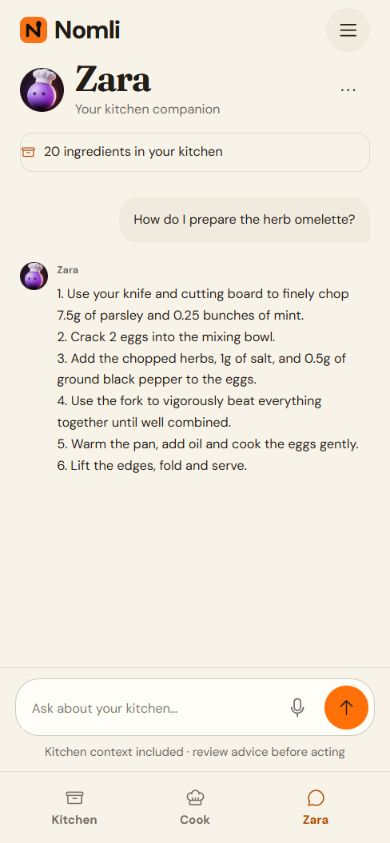
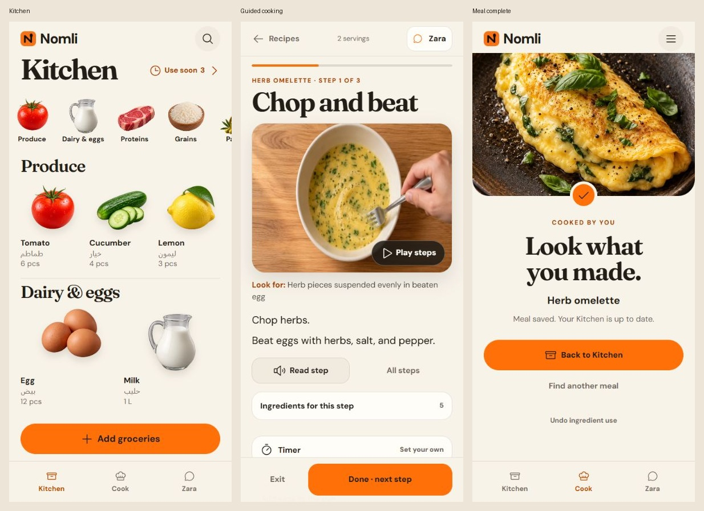

# Nomli M14.1 Zara correction APK

[Download Nomli-M14.1.apk](https://github.com/giza-maker/Artifact/releases/download/nomli-m14.1-v0.15.1/Nomli-M14.1.apk). Install over **Nomli Test** to retain inventory and connection settings. Version **0.15.1-m14.1**, code **24**; same application ID and retained signing certificate.

Fixes the standalone Zara layout reported from the phone. The moved app header was sharing a default flex row with the conversation, leaving only 221px for chat on a 390px viewport. The full route now uses a vertical layout, a readable title and a separately scrolling thread with a reachable composer. Compact layouts handle long English/Arabic drafts. Cooking chat retains its overlay and returns to the same step.

Android uses explicit light system bars with dark glyphs, plus matching cream launch/window/WebView surfaces. The actual APK's native configuration was verified; physical phone appearance and IME behavior still need device acceptance.

486 tests and content/art/media validation passed. Vite build, Capacitor sync and [Android CI](https://github.com/giza-maker/Artifact/actions/runs/41114064947) passed from source `5665ceae55c0e2a2a4e360382e8f50b4c9605b4f`. Local browser checks covered standalone Zara at normal/narrow sizes, long Arabic drafts and voice drawer at short heights, cooking chat at normal/short heights, the return to the same cooking step, inventory scrolling, menu bounds, and an unpaired ordinary browser. [Corrective design QA](../design-qa.md) records the missed M14 standalone-chat coverage; these checks do not claim every app feature was retested.

Signed APK: **95,876,272 bytes**; SHA-256 `b5da6efd34356caf2dae62b2e774405e501cd11d87371c90f4316c4cf9268a2b`. Retained certificate SHA-256 `8c02c3045c97327f5415451feb9ccb0db326322b90d460dde9f28a7c0b559ef0`. v2/v3 signatures, 16 KB alignment, ZIP CRC, all **231 bundled web assets** against the local production build, configured-secret exclusion and QA-harness exclusion verified. Published APK size and SHA-256 match the local verified file.

Evidence: [layout measurements](../artifacts/m14-1-zara-fix/layout-verification.json), [build verification](../artifacts/m14-1-zara-fix/build-verification.json). Screenshots use synthetic inventory and controlled native/assistant transport; live OCR/model accuracy and physical Android camera, speech, keyboard, Back and process-kill behavior are not established by these browser checks.



## Historical Nomli M14 warm editorial APK

[Download Nomli-M14.apk](https://github.com/giza-maker/Artifact/releases/download/nomli-m14-v0.15.0/Nomli-M14.apk). Install over **Nomli Test** to retain inventory and connection settings. Version **0.15.0-m14**, code **23**; package `com.nomli.mvp.validation`; minimum Android API 26, target API 36.

Option 1's warm editorial style now covers Kitchen, scanning, recipes, preparation, cooking, Zara, dialogs and utilities. Kitchen groups inventory into eight browsable sections over the existing 32 categories. Its image rail scrolls horizontally; the whole top bar scrolls with the page; Add groceries stays reachable above navigation. Local photos keep priority over the 272 food illustrations.

Cooking uses its existing 60 distinct step visuals and animations, one progress indicator, focused controls, an in-step Zara panel and a meal-completion screen. Preparation and actual-use buttons enable after their required confirmations. Reviewed deduction, explicit undo, recipe identity matching, local photo privacy and M13 draft recovery remain intact.

485 tests, content/art/media validation, Vite build, Capacitor sync and [Android CI](https://github.com/giza-maker/Artifact/actions/runs/41085676206) passed. Source `1a5f43f351452a739f07b446203470ece0849aef`; CI wall time 1m 57s. Signed APK **95,876,272 bytes**; SHA-256 `73a2ef1c68efd86b63641a278d12ded58941951aef6f1bd87b395443f30859a8`. Retained certificate SHA-256 `8c02c3045c97327f5415451feb9ccb0db326322b90d460dde9f28a7c0b559ef0`; v2/v3 signatures, 16 KB alignment, ZIP CRC, all **231 bundled web assets**, configured-secret exclusion and QA-harness exclusion verified. Published asset size and digest match the verified local APK.

Browser checks covered 390×844, 320×640 and 320×568: all-category picker scrolling, Arabic inventory search, Arabic receipt quantity `٣٠`, six-card review and confirmed import, prep gating, three cooking steps, media pause, timers, Zara reply/return, actual use `٠٫٥`, atomic deduction, confirmation gating, explicit undo and completion navigation. Ordinary browser preview also loaded without console errors. [Design QA](../design-qa.md) passed; screenshots use synthetic inventory and controlled native/AI transport. Physical Android camera, microphone, keyboard, hardware Back and process-kill acceptance remain pending.



## Historical Nomli M13 interruption-recovery APK

[Download Nomli-M13.apk](https://github.com/giza-maker/Artifact/releases/download/nomli-m13-v0.14.0/Nomli-M13.apk). Package com.nomli.mvp.validation; version 0.14.0-m13, code 22; minimum API 26, target API 36. Install over Nomli Test.

Unfinished scan reviews recover edited fields, card position, source files and individual grocery crops from local private storage. Zara restores unsent or interrupted questions and waits for Send. Cooking review restores the entered amounts for the same session and requires fresh confirmation before deducting stock. Recovery never sends a question, imports items or deducts stock automatically. Scan fingerprints and cooking-session IDs prevent duplicate imports and deductions. Android saves drafts with atomic file writes; recovery excludes connection credentials and stays outside inventory backups. Bilingual receipt titles have room beside ingredient artwork, with Keep item below the title.

Removed crops stay removed after restart, and completed drafts clear. Failed snapshot writes leave the app responsive. Reset and backup replacement require a saved draft-clear record first. An eight-second timeout stops subsequent recovery writes until reopen. Unreadable drafts stay untouched until explicit discard; inventory remains available. Existing content is unchanged: 88 ingredients, 20 recipes, 272 food-art entries across 32 categories, 60 steps and 120 cooking-media files.

Source 9f5de2e6ca9260d6ce6f0830de4c9791eb2812ed; CI 41002753592 (4m 00s). 474 JavaScript tests, content/art/media validation, Vite build, Capacitor sync and Android compilation passed. APK 95,868,080 bytes; SHA-256 dee26cfea54e376ad11116e11ab93f04f25fbacdd09c3fcd49896b4ed7dc2657. Certificate SHA-256 8c02c3045c97327f5415451feb9ccb0db326322b90d460dde9f28a7c0b559ef0; v2/v3 signatures, 16 KB alignment, ZIP CRC and all 231 production assets verified. Configured secrets and QA harness absent. Published size/digest match local APK.

Browser QA covered the production build and actual Capacitor wrappers with controlled native transport at 390×844 and 320×568. Receipt quantity ٢٤ and wizard position restored after reload, confirmation reset, then 6 items and EGP 243.62 spending committed exactly once. A crop restored, and its later removal stayed removed. A pending Zara question restored with request count 1 and no resend; explicit retry produced a reply and cleared the draft. Arabic actual-use amount ٣ restored unchecked from its session allocation while egg stock stayed 30, then explicit confirmation deducted 3 to 27 and remained 27 after reload. A failed snapshot write left the UI responsive and blocked reset; an 8-second stalled write entered quarantine. A corrupt draft was discarded while stock remained intact. Protected deployed health passed in 544 ms; content responses were controlled fixtures, not live-model accuracy tests. Physical Android camera, microphone, keyboard, hardware Back and process-kill acceptance remain pending.

Recovery regression tests are included in the 474-test suite.

## Historical Nomli M12 kitchen-to-cooking APK

[Download Nomli-M12.apk](https://github.com/giza-maker/Artifact/releases/download/nomli-m12-v0.13.0/Nomli-M12.apk). Package com.nomli.mvp.validation; version 0.13.0-m12, code 21; minimum API 26, target API 36. Install over Nomli Test.

Kitchen now gives empty inventory one Scan action and a secondary manual-add action; utilities sit under Kitchen tools. Ingredient entry starts with name, amount, unit and location, with expiry, photos, category and cooking details under More details. Inventory shows canonical food names while retaining original retail names. Arabic, Persian and English decimal quantities use the shared localized parser.

Cook has recipe search, All/Ready/Nearly-ready filters and readable photo cards. Items needing a measured weight are distinguished from missing ingredients. Recipe readiness and preparation come before calorie logging; all 60 steps can be previewed without changing stock. Successful scans return to Kitchen with a Find a meal action, while receipt spending remains recorded. Scan and Zara share one Connect Nomli setup; service address is advanced, a 10-second health check validates saves, and the selected Scan source type continues after setup. Zara offers local contextual next actions; prompts fill the question and still require explicit Send. Cooking chat remains an overlay over the unchanged cooking screen.

Source dd0ba48ee5c92372d3f2a7faea680f6c797fb413; CI 40988710065 (4m 39s). 441 JavaScript tests, content/art/media validation, Vite build, Capacitor sync and Android compilation passed. APK 95,855,875 bytes; SHA-256 895c89f0ce1dd1b16655b1e9146ce7694e2a22ef14b1dba413aa0338595efa6d. Certificate SHA-256 8c02c3045c97327f5415451feb9ccb0db326322b90d460dde9f28a7c0b559ef0; v2/v3 signatures, 16 KB alignment, ZIP CRC and all 232 production assets verified. Configured secrets and QA harness absent. Published size/digest match local APK.

Browser QA covered the production build and actual Capacitor wrappers with controlled native transport at 390×844, 320×568 and 320×360. Verified Arabic manual add and automatic identity matching; recipe search focus and availability filters; read-only step previews; preparation and cooking; delayed Zara reply across sheet dismissal with no abort; actual-use edit 4→3 preserved through chat; exact 3-egg deduction and guarded undo preserving the independently added apple. Reviewed six bilingual receipt cards, saved EGP 243.62, returned to Kitchen, and followed Find a meal. Unknown herb weights appeared as two amount checks; explicit test measurements entered with Arabic and English digits unlocked preparation without changing stock. Also verified shared setup and source continuation, advanced category Arabic search and return focus, scrolling/visible Save at 320×360, reachable chat composer, and calorie-entry access. Protected deployed health endpoint passed in 471 ms; scan/assistant content responses were controlled fixtures, not new live-model accuracy tests. Physical Android update, microphone, camera/QR, keyboard and hardware Back remain pending.

441 checks include 20-recipe/60-step preview coverage. The calorie diary, reviewed stock deduction/undo, local food art/media and deployed scanner/assistant Worker remain available.

## Historical Nomli M11.2 cooking chat APK

[Download Nomli-M11.2.apk](https://github.com/giza-maker/Artifact/releases/download/nomli-m11.2-v0.12.2/Nomli-M11.2.apk). Package com.nomli.mvp.validation; version 0.12.2-m11.2, code 20; minimum API 26, target API 36. Install over Nomli Test.

Zara opens as a chat sheet over preparation, the active cooking step and actual-use review. The cooking screen stays mounted behind it. The sheet shows the recipe, current phase and running or finished timer; Back to cooking, backdrop and Back dismiss it without changing the step.

Replies, voice controls and nested settings reuse the existing assistant. Chat rerenders never rebuild the underlying cooking form. Closing the sheet retains typed drafts, saved exchanges and pending replies, stops voice capture, restores focus and resumes cooking media according to the previous playback intent. Settings unwind before the sheet on Back; navigating to the full assistant closes the sheet. Drafts and unsaved actual-use edits survive navigation, but are not promised across a full app restart.

Source 199d7786c0c21fdc29f34a80e74cf80d0fd1efb9; CI 40967546204 (2m 50s). 412 JavaScript tests, content/art/media validation, Vite build, Capacitor sync and Android compilation passed. APK 95,847,683 bytes; SHA-256 3a5e4a7ff7512a4e2761cd33700429f233803bf9a28f538e6dfffa741b23f522. Certificate SHA-256 8c02c3045c97327f5415451feb9ccb0db326322b90d460dde9f28a7c0b559ef0; v2/v3 signatures, 16 KB alignment, ZIP CRC and all 232 production assets verified. Configured secrets and QA harness absent. Published size/digest match local APK.

Isolated browser/native-bridge QA at 390×844 and 320×360 verified preparation selections, Arabic drafts, delayed replies without abort, nested settings and Back, voice cancellation, full-assistant route changes, reachable composer actions, no horizontal overflow and focus restoration. A real one-minute timer expired while the sheet stayed open with the typed draft and focus intact. An edited egg quantity of 3 survived reply completion and sheet dismissal in final review without deducting stock. Controlled assistant responses and synthetic native transport were used; physical Android microphone, keyboard, hardware Back and update installation remain unverified.

The calorie diary, stock deduction/undo, 60 cooking demonstrations and deployed scanner/assistant service remain unchanged.

## Historical Nomli M11.1 cooking and Zara APK

[Download Nomli-M11.1.apk](https://github.com/giza-maker/Artifact/releases/download/nomli-m11.1-v0.12.1/Nomli-M11.1.apk). Package com.nomli.mvp.validation; version 0.12.1-m11.1, code 19; minimum API 26, target API 36. Install over Nomli Test.

Zara now shows an explicit Resume preparation, Resume cooking or Resume review button with the current recipe and step. Every cooking phase has a chat shortcut; active steps also show Continue chat. Returning to an existing exchange keeps the question instead of seeding a new step prompt.

Cooking/chat round trips preserve pending replies, including browser Back. Duplicate history events no longer cancel requests. Replies arriving during cooking update only chat controls, keeping timer/preparation/review fields intact; persistence restores focus to the active field. Opening chat clears its reply-ready indicator. Voice capture stops on navigation. Unrelated navigation and cooking mutations still cancel pending requests so stale advice cannot apply.

Source 6cd4850be1b5914fd4729513b3ff3ecb52900260; CI 40956619985 (4m 40s). 408 JavaScript tests, content/art/media validation, Vite build, Capacitor sync and Android compilation passed. APK 95,843,587 bytes; SHA-256 fbe290595f0f24cd119385805a3b5bfe92f38aca1f6d6301bd6628bd6c61b9b7. Certificate SHA-256 8c02c3045c97327f5415451feb9ccb0db326322b90d460dde9f28a7c0b559ef0; v2/v3 signatures, 16 KB alignment, ZIP CRC and all 232 production assets verified. Configured secrets and QA harness absent. Published size/digest match local APK.

390×844 and 320×568 browser/native-bridge QA verified the original abort, explicit return controls, bilingual unsent draft retention, pending replies through both Resume and browser Back, saved conversation reopening, background reply completion with timer field value 7 and focus retained, running timer continuity, read-indicator clearing, step-change cancellation, scrolling and no horizontal overflow. Synthetic native transport and a controlled delayed assistant response were used; no live AI or physical phone was used for this flow. Physical Android update/hardware acceptance remains pending.

The calorie diary, stock deduction/undo, 60 cooking demonstrations and deployed scanner/assistant service remain unchanged.

## Historical Nomli M11 calorie diary APK

[Download Nomli-M11.apk](https://github.com/giza-maker/Artifact/releases/download/nomli-m11-v0.12.0/Nomli-M11.apk). Package com.nomli.mvp.validation; version 0.12.0-m11, code 18; minimum API 26, target API 36. Install over Nomli Test.

Calories now has an offline daily food diary, explicit portions eaten, dated history, editing/removal and an optional user-entered goal. Kitchen includes a daily shortcut. Arabic, Persian and English numerals work; fractional portions are supported and ambiguous grouping is rejected.

Recipe pages show estimated kcal per serving and the total for the selected recipe size. A documented subset of 54 USDA SR Legacy references covers 17 of 20 recipes completely. Three recipes with labneh, zaatar or mixed-spice blends remain visibly incomplete and offer manual calorie entry. Generic references, portion weights and preparation states are documented in docs/NUTRITION.md; brand labels take precedence when entering packaged food.

Cooking does not mean eating: food logging never changes stock or spending, and cooking/stock undo never changes the food diary. Entries retain their original per-portion calorie snapshot. Diary and goal are included in local backups and excluded from Zara context. Existing inventory, photos, connection and step-specific cooking media remain available.

Source cad37f56e4fe0849bf1d7e4fb1a038b461800df6; CI 40945088800 (4m 17s). 403 JavaScript tests, content/art/media validation, Vite build, Capacitor sync and Android compilation passed. APK 95,839,491 bytes; SHA-256 8b7fb1cb983faef90a4d8a9fffd99d9d90b6365246b7e89d3fbf04a22e1a7d70. Certificate SHA-256 8c02c3045c97327f5415451feb9ccb0db326322b90d460dde9f28a7c0b559ef0; v2/v3 signatures, 16 KB alignment, ZIP CRC and all 232 production assets verified. Configured secrets and QA harness absent. Published size/digest match local APK.

Production browser QA at 390×844 and 320×568 verified Arabic calorie entry, fractions, invalid-input errors, goal set/remove, dated edits, recipe picker search, recipe scaling, incomplete-estimate manual entry, deletion, reload persistence, scrollable forms, focus restoration and no horizontal overflow. Console errors: none. Tests used an isolated local origin and synthetic food entries; no live nutrition/AI service or phone was used. Physical Android update acceptance remains pending.

Scanner/assistant Worker unchanged. All 60 cooking-step demonstrations remain bundled.

## Historical Nomli M10 visual cooking APK

[Download Nomli-M10.apk](https://github.com/giza-maker/Artifact/releases/download/nomli-m10-v0.11.0/Nomli-M10.apk). Package com.nomli.mvp.validation; version 0.11.0-m10, code 17; minimum API 26, target API 36. Install over Nomli Test.

All 60 steps across 20 recipes now show the current cooking action, with a distinct poster, motion and an observable Look for cue. The offline set contains 45 silent five-second clips and 15 four-frame illustrated sequences. New replacement images were generated with the built-in image generator; usable completed clips were retained as requested. Incorrect ingredient forms, preparation stages and layering were corrected before packaging. Active steps no longer repeat the finished-dish photograph.

Pause/replay works independently of the cooking timer. Media pauses off-screen, behind dialogs and in the background; a manual pause survives timer changes and returning to the same step. Reduced-motion settings show a still until explicit playback. Media never advances the recipe or changes inventory. Preparation, reviewed deduction, undo, Zara and scanning remain available.

Source 0ec1e932013e7f7671c425bfe7b336c2b2ff8a83; CI 40936298448 (3m 53s). 374 tests, content/art/media validation, Vite build, Capacitor sync and Android compilation passed. APK 95,831,299 bytes; SHA-256 b0928762eb8d62f5e3d1ce4d6da4a3f7aca7dce397fbeb807f6e9f9a477fbedb. Certificate SHA-256 8c02c3045c97327f5415451feb9ccb0db326322b90d460dde9f28a7c0b559ef0; v2/v3 signatures, 16 KB alignment, ZIP CRC and all 232 production assets verified. Configured secrets and QA harness absent. Published size/digest match the local APK.

390 × 844 and 320 × 568 browser/native-bridge QA verified local silent playback, illustrated-frame progression, pause across dialogs and timer rerenders, off-screen pause, scrolling, step navigation, required preparation, actual-use review, exact six-item deduction and undo. All 60 source visuals received review; 15 inaccurate scenes were replaced. All 45 retained clips decoded fully without errors. Camera/native transport was synthetic. Physical Android playback and update acceptance remain device checks.

All 120 media files (25,350,103 bytes) are bundled. Prompts and provenance: web/public/media/cooking/MANIFEST.json and content/cooking-sequences.json. Scanner/assistant Worker unchanged.

## Historical Nomli M9 guided cooking APK

[Download Nomli-M9.apk](https://github.com/giza-maker/Artifact/releases/download/nomli-m9-v0.10.0/Nomli-M9.apk). Install over Nomli Test. Package com.nomli.mvp.validation; version 0.10.0-m9, code 16; minimum API 26, target API 36. Saved inventory, photos and connection remain. No reset, rescan or new key required.

Cooking now has visual ingredient preparation cards, readable 20px instructions, prominent action titles, dish photography, numbered progress and heat cues. Optional timers use recipe-stated presets or your own duration and start only on tap. Read step uses the phone’s configured speech service, with Stop reading and cleanup on step changes, navigation, dialogs and backgrounding. Ask Zara prepares a current-step question; only Send shares it. Final review keeps editable actual-use amounts, one confirmed stock update and undo.

Timer rollback recovery preserves alert ownership after failed saves; restoration failures show a foreground-countdown warning.

Source 23d58f76ec11f854a828f871c40093b5aae54724; successful CI 40796074798 (4m 22s). All 350 JavaScript tests, content/art validation, Vite build, Capacitor sync and Android compilation pass. APK 70,402,992 bytes; SHA-256 542756b11ea90589866cdd88cb3384e7413363dbb23c538249f5deee055d6c2c. Retained certificate SHA-256 8c02c3045c97327f5415451feb9ccb0db326322b90d460dde9f28a7c0b559ef0; v2/v3 signatures, 16 KB alignment and ZIP CRC verified. All 111 production web assets match local dist; two empty Cordova placeholders expected. Configured secrets and QA harness absent. Published size/digest match local APK.

Browser QA at 390 × 844 and 320 × 568 verified readable instructions, reachable sticky controls, scrollable ingredients/review, no horizontal overflow, preparation confirmations, timer start/pause/reload, next/previous steps, overview dialog, Zara draft/return, final confirmation, exact six-item deduction and undo. Production Capacitor wrappers and Android bridge used synthetic native transport, including explicit speech stop, step cleanup and a retryable speech-engine error. The bilingual Carrefour fixture used synthetic measured herb weights (30 g/bunch and 20 g/bunch), never inferred in production. Reduced-motion rules were reviewed. Physical Android TTS quality, hardware/lifecycle and update acceptance remain phone checks.

Scanner/assistant Worker d3b10002-0f5c-45f7-ae0f-afe19040bd65 remains unchanged.

## Historical Nomli M8.4 bilingual receipt cooking APK

[Download Nomli-M8.4.apk](https://github.com/giza-maker/Artifact/releases/download/nomli-m8.4-v0.9.4/Nomli-M8.4.apk). Install over Nomli Test. Package com.nomli.mvp.validation; version 0.9.4-m8.4, code 15; minimum API 26, target API 36. Saved inventory, photos and connection remain. No reset, rescan or new key required.

Every explicit bilingual clause must resolve to the same cooking ingredient. Curated retail word orders, bunch packaging, localized digits and full compact forms now match; conflicting descriptions, unknown brands and preparation/formulation ambiguity do not auto-link. Existing clear unlinked stock repairs on startup or confirmed restore without rescanning. Quantities, receipt finance, explicit opt-outs, valid manual identities and frozen allocations remain protected.

Recipe rows show herb bunches as present with weight needed instead of falsely describing them as absent. A compact Enter weight dialog accepts measured grams per unit using Arabic or English digits, revalidates the item snapshot and saves only gramsPerUnit. Active allocations cannot be changed. Measurement-only shortages stay out of shopping; duplicate review panels are removed. Salt can use canonical salt artwork despite an old condiment shelf category, without rewriting that category.

Source dfb250b0086eb2b694a79648ff1909a21ce386de; successful CI 40744969784 (2m 57s). All 321 JavaScript tests, content/art validation, Vite build, Capacitor sync and Android compilation pass. APK 70,390,704 bytes; SHA-256 d6b1fd4da3a6803fc0e03a7a634ee207676283470dfba1400b7f62df248d892d. Retained certificate SHA-256 8c02c3045c97327f5415451feb9ccb0db326322b90d460dde9f28a7c0b559ef0; v2/v3 signatures, 16 KB alignment and ZIP CRC verified. All 111 production web assets match local dist; two empty Cordova placeholders expected. Configured secrets and QA harness absent. Published size/digest match local APK.

390 × 844 browser QA used production Capacitor wrappers and the actual Android bridge with synthetic native transport. The exact six bilingual receipt lines imported without manual identity selection; confirmed spending remained EGP 243.62. Eggs, salt, ground pepper and oil immediately covered the omelette. Parsley and mint each showed one bunch in Kitchen with weight needed. Synthetic measured test values 30 g/bunch and 20 g/bunch, entered using Arabic and English digits, enabled preparation. Final review deducted 4 eggs, 0.5 parsley bunch, 0.25 mint bunch, 2 g salt, 1 g pepper and 10 ml oil; undo restored all original quantities. Unlinked saved inventory and confirmed backup restoration repaired all six names. Salt artwork was corrected. Utilities showed v0.9.4. No console errors or horizontal overflow; lower panels remained scrollable. Camera, storage and backup selection were simulated. Physical update/hardware acceptance remains a phone check.

Scanner/assistant Worker d3b10002-0f5c-45f7-ae0f-afe19040bd65 remains unchanged.

## Historical Nomli M8.3 recipe stock review APK

[Download Nomli-M8.3.apk](https://github.com/giza-maker/Artifact/releases/download/nomli-m8.3-v0.9.3/Nomli-M8.3.apk). Install over Nomli Test. Package com.nomli.mvp.validation; version 0.9.3-m8.3, code 14; minimum API 26, target API 36. Inventory, photos and connection remain. No reset, rescan or new key required.

Unique strict food names now establish cooking identity independently of shelf category. Arabic ة/ه and hamza variants normalize consistently in names and packaging words. Backup replacement repairs clear links inside the confirmed transaction. Active cooking freezes only allocated stock; other lots can repair, with deferred repair after completion/cancellation.

Missing recipe requirements now show matching Kitchen candidates and the specific unlinked, opt-out, unit, recorded-date or conflicting-identity reason. Compatible candidates offer explicit Use as confirmation, with live-state revalidation and no quantity change. Unsupported processing/formulation, expired lots, incompatible units, frozen allocations and existing conflicting identities go to item review. No weights, expiry or dietary facts are inferred.

Source f24a86941ce5ec872736722dfd883070343079d3; successful CI 40731042743 (5m 30s). All 310 JavaScript tests, content/art validation, Vite build, Capacitor sync and Android compilation pass. APK 70,390,704 bytes; SHA-256 4496b07d76b854214e122d34d6b7460b5564652fc122cbe973b63324449f79eb. Retained validation certificate, v2/v3 signatures, 16 KB alignment and ZIP CRC verified. All 111 production web assets match local dist; two empty Cordova placeholders expected. Configured secrets and QA harness absent. Published size/digest match local APK.

390 × 844 browser QA used production Capacitor wrappers and actual Android native-bridge.js with synthetic native transport. Eggs Medium 30pcs counted under Dairy. Unknown Brand Eggs 30pcs showed a recipe match; Cancel left it missing, confirmation supplied 4 recipe eggs without changing the saved 30 pieces, and reload retained the link. Synthetic backup restoration produced a linked بيض متوسط ٣٠قطعه item under Other before any restart. A linked parsley bunch showed Quantity units need review; entering a synthetic measured 30 grams per bunch covered the 15-gram requirement. Utilities showed v0.9.3. No console errors or horizontal/modal overflow. Camera, storage and backup selection were simulated. No Android device was connected for hardware verification.

Scanner/assistant Worker d3b10002-0f5c-45f7-ae0f-afe19040bd65 remains unchanged.

## Historical Nomli M8.2 Kitchen/Cook sync APK

[Download Nomli-M8.2.apk](https://github.com/giza-maker/Artifact/releases/download/nomli-m8.2-v0.9.2/Nomli-M8.2.apk). Install over Nomli Test; existing inventory, photos and connection remain. Package com.nomli.mvp.validation; version 0.9.2-m8.2, code 13; minimum API 26, target API 36. No reset, rescan or new key required.

Clear product names such as Eggs Medium 30pcs, Bell Peppers, Carrots Tray, zucchini/courgette and Arabic equivalents now prefill editable cooking links. All 272 food types declare a nullable canonical mapping; 63 have direct compatible mappings, and all 88 primary canonical English/Arabic names resolve under shared display categories. Artwork aliases alone never establish identity. Ambiguous formulations, preparation states, species and unknown brands stay for review; no grams, expiry or dietary facts are inferred.

Startup repair skips active cooking, preserves valid manual links and opt-outs, and swaps displayed state only after successful persistence. Unit conversion, expired-stock exclusion, atomic deduction, replay and undo keep their existing checks. Native write timeouts quarantine further writes until reopen because the late write outcome may be unknown.

Source 1116c9e9c16674df3b6d92ff93cdd822f708cdaa; successful CI 40633270436 (4m 28s). All 294 JavaScript tests, content/food-art validation, Vite build, Capacitor sync and Android compilation pass. APK 70,386,608 bytes; SHA-256 78a8f11be7aa9338cd0a0766af71e2116bb016dbbaf768e115336d05988af80e. Retained validation certificate, v2/v3 signatures, 16 KB alignment and ZIP CRC verified. All 111 production web assets match local dist; two empty Cordova placeholders expected. Configured secrets and synthetic QA harness absent. GitHub asset size/digest match local APK.

390 × 844 browser QA used production native wrappers, actual Capacitor Android native-bridge.js and synthetic native transport. Startup repaired nine clear unlinked items; herb omelette requirements showed exact Kitchen coverage. Full preparation/cooking/review deducted eggs 30→26 pieces and Undo restored 30; reload retained links and amounts. New receipt cards prefilled Egg, Bell pepper and Carrot; changing the name to Chocolate milk cleared stale Egg identity. Explicit Carrot unlink remained unlinked after saving/reload. The same new scan supplied the recipe eggs without a manual ingredient selection. A stalled Preferences.set exited loading after eight seconds with an original-inventory/reopen message. No console errors. Native camera/storage were simulated; physical Android install, permissions and hardware remain phone checks.

Scanner/assistant service remains the verified Worker d3b10002-0f5c-45f7-ae0f-afe19040bd65; API contracts and credentials are unchanged.

## Historical M8.1 supermarket artwork APK

[Download Nomli-M8.1.apk](https://github.com/giza-maker/Artifact/releases/download/nomli-m8.1-v0.9.1/Nomli-M8.1.apk). Install over existing Nomli Test. Package com.nomli.mvp.validation; version 0.9.1-m8.1, code 12; minimum API 26, target API 36. Same signing key; inventory, photos and connection remain. No new account, key or reset required.

272 specific food illustrations in 17 lossless transparent atlases cover common supermarket types, including fresh produce, meat, dairy, grains, bakery, canned/frozen foods, snacks, drinks, baking supplies and MENA staples. Thirty-two editable categories use matching representative artwork. Arabic/English whole-phrase aliases distinguish rice varieties, pasta shapes, prepared food and common drink brands. Unmatched brands use food-type/category artwork; this is not an exhaustive SKU database. Local photos take priority.

Source ed456aefcbb4588292d37ecde0b442b7fec8a504; successful CI 40628893894 (3m 45s). All 268 JavaScript tests, content and food-art validation, Vite build, Capacitor sync and Android compilation pass. APK 70,382,512 bytes; SHA-256 eae8f012157cbbfc71d2de6fd975ce774ae591702e10e5ec2db98c0752d6799b. Retained validation certificate, v2/v3 signatures, 16 KB alignment and ZIP CRC pass. All 111 production web assets match local dist; two empty Cordova placeholders expected. Configured secrets and QA harness absent. Published asset size/digest match local APK.

390 × 844 browser QA used production Capacitor/native wrapper with actual Android native-bridge.js and synthetic Android transport. Five Arabic receipt cards resolved distinct rice, vermicelli, orzo, cola and lemon-lime soda art. Review saved five items and exact EGP 109.00; artwork persisted after reload. A confirmed local photo took priority after reload; removing it restored food artwork. All 32 category icons rendered in a searchable sheet with independent scrolling (514 px viewport, 1722 px content). No horizontal overflow or console errors. Camera, storage and file selection were simulated; physical Android acceptance remains pending.

Live OCR regression fixtures passed: Arabic receipt SAR 23.00, English PDF AED 39.62 with AED 1.89 additional tax, and a two-product grocery photo with separate crop regions. Observed times 3.15 s, 3.64 s, 23.89 s; final deployed-service Arabic receipt replay 28.35 s. These observations are not latency or accuracy guarantees. Worker d3b10002-0f5c-45f7-ae0f-afe19040bd65 keeps receipt/grocery model separation, bounded fallback and the 32-category server allowlist. Gemini rejected the expanded nested enum with HTTP 400; its provider schema now accepts nullable text while the prompt lists choices and runtime validation converts unknown IDs to null. OpenAI strict schema retains the enum.

## Historical M8 card review APK

[Download Nomli-M8.apk](https://github.com/giza-maker/Artifact/releases/download/nomli-m8-v0.9.0/Nomli-M8.apk). Install over existing Nomli Test. Package com.nomli.mvp.validation; version 0.9.0-m8, code 11; minimum API 26, target API 36. Same signing key; existing inventory, photos and connection remain. No new account, key or reset required.

One food item per review card, with Back/Next and an All items jump list. Category/storage suggestions are prefilled and editable. Expiry, cooking links, measured weights, costs, crop tools and merge choices sit under More details. Final Add stays in the footer and requires confirmation. Unknown quantities still need correction; missing finance can be explicitly excluded.

Sixteen realistic category images appear in inventory and category pickers. Legacy item names receive fallback art without rescanning; uploaded local photos take priority. Categories remain broad display metadata, not canonical cooking identities or allergen/weight facts.

Source 6dcfa83eaf9c91ef5580b9fc170dd83d56aad669; successful CI 40620367726 (4m 42s). All 248 JavaScript checks, content validation, Vite build, Capacitor sync and Android compilation pass. APK 46,025,882 bytes; SHA-256 634296f40af4c298e482043afa62c66135cd33bbecf2151bb31b0f245fcdbfca. Retained validation certificate, v2/v3 signatures, 16 KB alignment and ZIP CRC pass. All 92 production web assets match local dist; two empty Cordova placeholders expected. Configured secrets and QA harness absent. Published asset size/digest match local APK.

390 × 844 browser QA used actual Capacitor core/Android native-bridge.js and production native wrapper with synthetic Android transport. Back preserved Arabic quantity edits; skip saved four selected items with spending excluded; full review saved five items and exact EGP 109.00. Repeating that source was a no-op. Categories and an uploaded local photo survived reload; the photo hid category artwork. Category picker displayed all 16 food icons and scrolled. Grocery crop selection updated the card photo immediately; removing it restored the category icon. Advanced card content scrolled (622 px viewport, 1488 px content) without horizontal overflow. No console errors. Camera, plugin storage and file selection were simulated.

Live production OCR returned editable categories for an Arabic receipt PNG (SAR 23.00), an English PDF (AED 39.62 with AED 1.89 additional tax) and a two-product grocery image with individual crop regions. Categories included vegetables, dairy, legumes, condiments and oil. Observed times: 17.33 s, 6.89 s, 4.34 s. These are fixture observations, not latency or accuracy guarantees. Worker c5dfb215-9db7-4761-ab67-a369d62f9234 retains receipt/grocery model separation and bounded fallback.

Physical installation, permissions, keyboard and hardware remain phone checks.

## Historical M7.2 receipt APK

[Download Nomli-M7.2.apk](https://github.com/giza-maker/Artifact/releases/download/nomli-m7.2-v0.8.2/Nomli-M7.2.apk). Update existing Nomli Test. Package com.nomli.mvp.validation, version 0.8.2-m7.2, code 10, minimum API 26, target API 36. Same signing key and inventory schema; no reset or new account/API key needed.

Receipt text follows Arabic/English direction automatically. Quantities, prices and optional unit weights accept Arabic-Indic, Persian and ASCII digits with unambiguous decimal/grouping separators. Monetary arithmetic stays exact in integer minor units.

Receipt recognition uses the faster primary model checked against these fixtures. One fallback attempt is allowed for timeout or upstream 502/503/504, within the original 60-second deadline. Auth, quota, schema and cancellation errors do not retry. Upstream inference may still incur cost after cancellation. Manual retry reuses the selected source. Every result remains a draft until reviewed.

APK source bd68c5fb2ec1b82ba03ccb8206a0b3363adbc65b; CI 40604058146 (3m 53s), including 218 JavaScript checks. Final scanner source bb7e473361ce39e9dec7595d093823254e6bfd2d; 225 JavaScript checks pass locally after routing/fallback changes. Content validation, Vite build, Capacitor sync and Android compilation pass. APK 43,891,693 bytes; SHA-256 e4c41e43f66046e835b9be923e43ed6a957018ddba8664b77836995b71eced50. Retained signing certificate, v2/v3 signatures, 16 KB alignment and ZIP CRC pass. All 90 production web assets match local dist; two empty Cordova placeholders expected. Configured secrets and QA harness absent. Published asset size/digest match local APK. Server-only routing/fallback changes do not alter bundled client assets.

Four synthetic bilingual receipts passed production OCR: Arabic/English labels and Arabic/Persian/ASCII numerals, in PNG and one-page PDF. All returned SAR 2300 minor units, zero additional tax/discount, 1.5 kg tomatoes and 2 L/2000 ml milk, with the printed date. Observed times: 3.83 s, 3.78 s, 13.64 s, 3.50 s. Two existing AED receipt fixtures and grocery image regions also passed via the real scan client with exact-file fingerprint validation. These are fixture observations, not latency guarantees or proof for the user's original receipt.

390 × 844 browser QA used actual Capacitor core/Android native-bridge.js and production native wrapper with synthetic Android transport. Arabic/Persian receipt edits saved exact SAR 23.00 and two inventory lines, retained after reload. Malformed grouping blocked with field focus; retry reused the same source; cancel left saved inventory unchanged. Long review panel scrolled (622 px viewport, 3229 px content), with no horizontal overflow or console errors. Device picker, camera, storage and speech were simulated.

Physical microphone, camera, filesystem, permission prompts and update installation remain phone checks. User supplied an error screenshot, so the specific original receipt has not been retested.

## Historical M7.1 APK

[Download Nomli-M7.1.apk](https://github.com/giza-maker/Artifact/releases/download/nomli-m7.1-v0.8.1/Nomli-M7.1.apk). Install over existing Nomli Test. Package com.nomli.mvp.validation, version 0.8.1-m7.1, code 9, minimum API 26, target API 36. Same signing key and inventory schema; no reset or new account/API key needed.

Fixes the loader deadlock blocking photo saves, voice startup, file picking and backups. Loaders resolve plain handles instead of Capacitor proxies.

Source 7c7e3fd27a79525b29815877f0deb49dc815018d; successful CI 40597589060 (4m 19s). 204 JavaScript tests, content validation, build, Capacitor sync and Android compilation pass. APK 43,891,693 bytes; SHA-256 ae8a476b2c2c82061d65e2153851c0fa84a4a13dc2c7b1eb0c3e5c276fcb3d10. Retained signing certificate, v2/v3 signatures, 16 KB alignment and ZIP CRC pass. All 90 production web assets match; two empty Cordova placeholders expected. Configured secrets and QA harness absent. Published size/digest match local APK.

Real SDK browser regression used synthetic Android transport. Camera/crop/photo save/reload, voice callbacks and backup callbacks completed. Physical microphone, camera, filesystem, permissions and update installation remain phone checks.

## Historical M7 release — known loader defect, use M7.1

[Download Nomli-M7.apk](https://github.com/giza-maker/Artifact/releases/download/nomli-m7-v0.8.0/Nomli-M7.apk). Install over existing **Nomli Test**. Package `com.nomli.mvp.validation`, version **0.8.0-m7**, versionCode **8**, minimum API **26**, target API **36**. Same retained signing certificate; actual update installation remains a phone check.

M7 adds persistent individually cropped ingredient photos, complete recipe artwork, chronological Zara chat with bottom composer and voice drawer, searchable mobile selectors and compact cooking/inventory layouts. Scanning and live Zara reuse existing private connection. Old discarded captures cannot be recovered. Receipt/PDF/expiry scans never become ingredient photos. JSON backups contain photo reference IDs, not media bytes.

Built from `5e3fc5751c8d7e886d3c326956e62c38225df382` in successful [CI run 40591130479](https://github.com/giza-maker/Artifact/actions/runs/40591130479); Android job took 1m 42s. All **200 JavaScript tests**, content validation, production build, Capacitor sync and Android compilation pass. APK: **43,891,693 bytes**. SHA-256:

```text
67f155a30b769e17747ae4c170b1fb97f627969a68d7dbae9705c3e637e606bb
```

APK Signature Schemes v2/v3, 16 KB alignment and ZIP CRC pass. Certificate SHA-256: `8c02c3045c97327f5415451feb9ccb0db326322b90d460dde9f28a7c0b559ef0`, matching prior validation releases. All 90 production web assets match byte-for-byte; two empty Cordova placeholders are expected. Configured provider key/device code, private files and QA harness are absent. GitHub asset size/digest match local APK.

Browser checked photo save/reload, grocery review, nested selectors, focus, live search, all 20 recipe mappings and detail art, live Zara reply and synthetic speech review at 390×844 and 320×640. Voice permission handoff and error reporting were hardened after an installed-APK silent Speak report. No physical phone/emulator QA ran; that phone’s root cause remains unconfirmed. Actual capture/storage, microphone/provider/language support, keyboard/accessibility, background notifications and update installation remain pending in [TESTING.md](TESTING.md).

## Historical M6 release

[Download Nomli-M6.apk](https://github.com/giza-maker/Artifact/releases/download/nomli-m6-v0.7.0/Nomli-M6.apk). Install over existing **Nomli Test**. Package `com.nomli.mvp.validation`, version **0.7.0-m6**, versionCode **7**, minimum API **26**, target API **36**. Retained signing certificate matches M1–M5. Actual update installation remains a phone check.

M6 fixes scan merge-target ownership, repeated/overflowing scan warnings, timer cancellation ownership across saved transitions and backup export success before stream closure. Existing scanning, linked inventory, preparation, cooking, reviewed actual-use deduction/undo, live Zara and reviewed Arabic/English voice remain available. Use the existing private Scan connection; no new account or Nomli API key is required.

Built from `d30cd583d40ccdb1c5ce6656d46a888d18f453f4` in successful [CI run 40549447675](https://github.com/giza-maker/Artifact/actions/runs/40549447675); Android job took 2m 34s. All **171 JavaScript tests**, content checks, production build, Capacitor sync and Android compilation pass. APK: **42,091,800 bytes**. SHA-256:

```text
2afe8e7eb19a4dd458b3a8396b9b2f22bb24985b91b919c290c5256a6325c2d8
```

APK Signature Schemes v2/v3, 16 KB alignment and ZIP CRC pass. Certificate SHA-256: `8c02c3045c97327f5415451feb9ccb0db326322b90d460dde9f28a7c0b559ef0`. All 72 packaged production web assets match byte-for-byte; two empty Cordova placeholders are expected. Configured provider key/device code and test harness are absent. GitHub asset size and SHA-256 match the local APK.

Live synthetic PNG/PDF scans returned expected quantities and AED 39.62 total. Direct production Zara calls returned a reviewed quantity correction and an Arabic step-2 answer with 200 g oats and no active-session proposals. Browser checks covered stock conversion, preparation/reload, timer cancellation rollback/retry, voice review, deduction/undo, receipt/spending and backup restore. Browser native features were simulated; a local Zara relay failed safely while direct production calls passed. These checks are not general accuracy or availability benchmarks.

No physical-phone or emulator QA ran. Actual microphone/permissions, language support, camera/QR/SAF, background notifications, keyboard/accessibility, force-stop persistence and installation remain pending in the [M6 acceptance checklist](TESTING.md).

## Historical M5 release

[Download Nomli-M5.apk](https://github.com/giza-maker/Artifact/releases/download/nomli-m5-v0.6.0/Nomli-M5.apk). Install over existing **Nomli Test** using the retained validation update channel. Package `com.nomli.mvp.validation`, version **0.6.0-m5**, versionCode **6**, minimum API **26**, target API **36**. Package metadata and signing certificate match were verified; actual update installation remains a phone check.

M5 adds optional Android voice input for Zara. Choose English (US), Arabic (Saudi Arabia) or Arabic (Egypt), then **Speak → Finish → edit transcript → Use transcript → Send question**. Use appends to the existing draft; a separate Replace action replaces it. Transcript review blocks Send. Voice results never execute commands, send automatically or change stock.

Android's default speech service may process audio online. Requested locale support and installed language packs vary; offline recognition is not guaranteed. Nomli stores no audio and keeps capture/review text in memory only. Once sent, question text follows the existing local conversation/backup behavior. No extra Nomli speech API key is required. Scanning and live Zara reuse the existing private Scan connection and unchanged M4 protected Gemini service.

Built from `aae7375b35563ba5dbc5945dca84e599333f1b36` in successful [CI run 40542738894](https://github.com/giza-maker/Artifact/actions/runs/40542738894); Android job took 4m 08s. All **161 JavaScript tests**, content checks, production build, Capacitor sync and Android compilation pass. APK: **42,091,800 bytes**. SHA-256:

```text
03a453d141a837c868b4cde1567a984cb166f8bbeb341901e24acc53f1926716
```

APK Signature Schemes v2/v3, 16 KB alignment and ZIP CRC checks pass. Certificate SHA-256: `8c02c3045c97327f5415451feb9ccb0db326322b90d460dde9f28a7c0b559ef0`. All 72 packaged production web assets match byte-for-byte; two generated Cordova placeholders are empty. Configured provider key and device code are absent. GitHub's uploaded asset size and SHA-256 match the local APK. Merged manifest includes runtime microphone permission, optional microphone hardware and speech-service visibility.

Browser QA used synthetic microphone results, then a real Zara request after explicit Send. Arabic editing, append/replace, blank/overflow guards, denied/unavailable errors, cancellation and unchanged inventory passed. This does not establish actual microphone recognition. No physical-phone QA has run. Follow the [M5 voice acceptance checklist](VOICE.md), including permission handling, language availability, noisy-kitchen recognition, interruption/background cleanup, keyboard and update installation. Existing camera/QR/SAF, notification and persistence device checks remain pending.

## Historical M4 release

[Download Nomli-M4.apk](https://github.com/giza-maker/Artifact/releases/download/nomli-m4-v0.5.0/Nomli-M4.apk). Install over M1/M2/M3 **Nomli Test** using the retained validation update channel. Package `com.nomli.mvp.validation`, version **0.5.0-m4**, versionCode **5**, minimum API **26**, target API **36**. Package metadata and certificate match were verified; actual update installation remains a phone check.

M4 adds live Zara grounded in inventory, curated recipes and the current cooking step with its frozen preparation plan. Quantity corrections and recipe/serving proposals require separate review and confirmation. Active cooking blocks proposals. Substitution advice does not rewrite recipes or allocated stock. Voice input remains future work.

Use the existing private Scan connection for Zara. Both scanning and Zara now use Gemini 3.5 Flash-Lite through the protected Worker. Google receives kitchen context only on an explicit Send; the latest six exchanges travel with the request. Up to 20 exchanges stay locally and appear in backups; private connection credentials stay outside backups.

Built from `533ae81a1c8cfe75b843e8469b9fb884d69f6e7a` in successful [CI run 40534182533](https://github.com/giza-maker/Artifact/actions/runs/40534182533); Android job took 3m 48s. All **142 automated tests**, content checks, production build and Capacitor sync pass. APK: **42,067,224 bytes**. SHA-256:

```text
60ab9d70541ac11d7ddb395b9b456e22548af08230041636af8b057536b67943
```

APK Signature Schemes v2/v3, 16 KB alignment and ZIP CRC checks pass. Certificate SHA-256: `8c02c3045c97327f5415451feb9ccb0db326322b90d460dde9f28a7c0b559ef0`. All 72 packaged production web assets match byte-for-byte; two generated Cordova placeholder files are empty. Configured provider key and device code are absent. Published GitHub asset size and SHA-256 match the local APK.

Phone test: Scan connection → Zara → ask about current inventory → review a proposed correction → confirm → verify Kitchen. Then start cooking, ask about the current step, return to cooking and test background timer behavior. See the [full M4 checklist](ASSISTANT.md).

No physical-phone QA has run. Native camera/QR/SAF permissions, notifications, keyboard, force-stop persistence and update installation remain unverified.

## Historical M3 release

M3 provides **Nomli Test** on Android 8 or later: version **0.4.0-m3**, versionCode **4**, minimum API **26**, target API **36**. Package `com.nomli.mvp.validation` and the retained validation signing certificate support M1/M2 updates. Package, version and API levels were verified with `aapt`. Actual update installation remains a phone check.

M3 adds explicitly linked kitchen stock, a static catalog of 20 curated recipes, measured count-to-mass conversions, preparation and tool confirmation, resumable timers, reviewed actual-use deduction and undo. Inventory and cooking work locally. Receipt recognition continues through the unchanged protected M2 Gemini service; live Zara and voice remain M4 work.

Built from source commit `08c8c47a300239e90f7b0c14ed077772246f34ea` in successful [CI run 40516558999](https://github.com/giza-maker/Artifact/actions/runs/40516558999). All 110 automated tests, content checks, production build and Capacitor sync pass. Verified APK: **42,063,128 bytes**. SHA-256:

```text
d0fb13d2a1c2cf5c954dd035cff22fc07a0cab700bfa1d802940fc7b49d0f1fe
```

APK Signature Schemes v2/v3, 16 KB alignment and ZIP CRC checks pass. Signing certificate SHA-256 is `8c02c3045c97327f5415451feb9ccb0db326322b90d460dde9f28a7c0b559ef0`, matching the retained validation certificate. All 72 packaged production web assets match byte-for-byte; two generated Cordova placeholder files are empty as expected. The configured provider key and device access code are absent from the APK.

Release asset: [Nomli-M3.apk](https://github.com/giza-maker/Artifact/releases/download/nomli-m3-v0.4.0/Nomli-M3.apk). Published GitHub asset size and SHA-256 match the verified local APK.

## M3 phone acceptance checklist

No physical-phone QA has been completed. Test these behaviors before wider distribution:

1. Install M3 over the M1/M2 validation app. Confirm inventory remains and version reports `0.4.0-m3`.
2. In **Kitchen**, add or edit stock and explicitly choose each cooking ingredient. For count-to-mass use, enter measured or printed grams per current unit. Confirm links survive force-close and reopen.
3. Open **Cook**, choose a recipe and servings, then check linked-stock availability. Confirm recorded past-date lots are excluded and missing or incompatible stock is explained.
4. Start cooking. In **Prepare**, check ingredients and confirm tools. Measure ingredients as needed; confirm partial preparation survives reopening and the active session keeps its original servings.
5. Advance through steps, start a timer, then background and force-close the app. Reopen and confirm the timer follows its saved deadline. Check native notification permission, delivery and cancellation behavior.
6. Review actual quantities used, including zero use where appropriate. Use the system keyboard, scroll to the final controls and save. Confirm stock and the meal persist together after reopening, with no second deduction from repeated save.
7. Add a stock top-up, then open **Recent meals** and choose **Undo**. Confirm only recorded use is restored and the top-up remains. Confirm deleted stock or changed cooking identity, unit or conversion blocks undo.
8. Reuse the private scan setup below. Test QR permission, connection test/save, native SAF receipt selection and camera capture. Review and save scanned items, optionally linking new stock or compatible merges for cooking. Confirm exact-file replay does not relink stock.
9. Export and restore a validated backup. Confirm cooking metadata persists and scan access credentials remain outside inventory backups. Check keyboard access and lower Save/Undo controls on the physical screen.

Camera, QR, SAF, notifications, keyboard, update installation and force-stop persistence remain unverified on a phone. See [M3 browser and domain evidence](VERIFICATION.md).

## Historical M2 release

Install **Nomli Test** on Android 8 or later. M2 updates the M1 validation app because it keeps package `com.nomli.mvp.validation` and the same signing certificate. It remains separate from the earlier Nomli demo.

Version: **0.3.0-m2**, versionCode **3**. Minimum API **26**, target API **36**.

M2 adds reviewed receipt image/PDF recognition, editable quantity and receipt fields, atomic local inventory updates, exact-file deduplication, separate scan configuration and native Android QR/file-picking bridges. Inventory works offline; recognition needs internet.

Built from commit `2f3a51bc3e1634fca2c73c55613ceb977d5c1a6f` in [CI run 40361683245](https://github.com/giza-maker/Artifact/actions/runs/40361683245), which passed in 4m 14s with all 69 automated tests. Local output: `artifacts/Nomli-M2.apk`, **42,046,744 bytes**. SHA-256:

```text
5f288d5e016253a7302b4d6b444ec1a4a27c40250cf2f251186ccf20ee75c9e5
```

APK Signature Schemes v2 and v3 and 16 KB alignment pass. Signing certificate SHA-256 remains `8c02c3045c97327f5415451feb9ccb0db326322b90d460dde9f28a7c0b559ef0`. All 72 packaged production web assets match the build byte-for-byte. Two generated Cordova placeholder files are empty as expected. The configured provider key and device access code are absent from the APK.

[Download M2 APK](https://github.com/giza-maker/Artifact/releases/download/nomli-m2-v0.3.0/Nomli-M2.apk). GitHub's uploaded asset size and SHA-256 match the verified local APK.

### M2 private scan setup

The setup QR is local at `.tools/pairing/nomli-scan-setup.png`. It contains private connection details. Never publish or attach it to a release.

1. Open the QR on a computer.
2. On Android, open **Scan**, then **Connection**.
3. Choose **Scan setup QR** and scan the code.
4. Choose **Test**, confirm the connection succeeds, then choose **Save**.

The live service uses Gemini 3.1 Flash-Lite through `https://nomli-scan-proxy.ahmed-aljazayeerly.workers.dev`. Its provider key is an encrypted server-side secret.

### Historical M2 phone acceptance checklist

No physical-phone QA has been completed. Test these behaviors before wider distribution:

1. Install M2 over M1. Confirm existing inventory remains and app reports version `0.3.0-m2`.
2. Complete private QR setup, connection test and save.
3. Pick a receipt through the native Storage Access Framework picker, then repeat with camera capture.
4. Review extracted package quantities, units, storage, merchant, currency, tax, discount and total. Correct anything wrong before saving.
5. Save, reload and confirm inventory and receipt state persist together.
6. Scan the exact same file under the same kind and confirm duplicate handling. A different photo of the same document is not an exact-file duplicate.
7. Run grocery and expiry scans against an existing item. Confirm grocery does not create a phantom receipt and expiry does not change existing quantity.
8. Export an inventory backup and confirm it contains no scan access code.
9. Force-close and reopen. Confirm inventory and scan connection behavior, then verify an M1-to-M2 update install.

Native QR scanning, SAF picker, camera permissions, Preferences across force-stop and update installation remain unverified until this checklist runs on a phone.

## Historical M1 release

M1 provided fresh local inventory, explicit quantities and units, storage and optional expiry provenance, native Preferences persistence and validated JSON backup/restore. Synthetic scan imports were disabled; OCR, product lookup, voice, live Zara and cloud sync were not connected.

M1 was version `0.2.0-m1`, versionCode 2, built from commit `3c0c0dc1f02bfc5287174143fcf9ad66ab0cffa9` in [CI run 40342137040](https://github.com/giza-maker/Artifact/actions/runs/40342137040). All 24 automated tests and Android compilation passed. Its APK was 42,034,456 bytes with SHA-256 `7a98c4895459b57a8b95fc22f73656fd27dce9d3e74167cadfd77c20d520d546`. Signature Schemes v2/v3, 16 KB alignment and all 72 packaged web assets were verified. [Download M1 APK](https://github.com/giza-maker/Artifact/releases/download/nomli-m1-v0.2.0/Nomli-M1.apk).

Windows verification helper: `docs/verify-apk.ps1`; requires Java on PATH (or JAVA_HOME) and a complete installed Android build-tools version.
