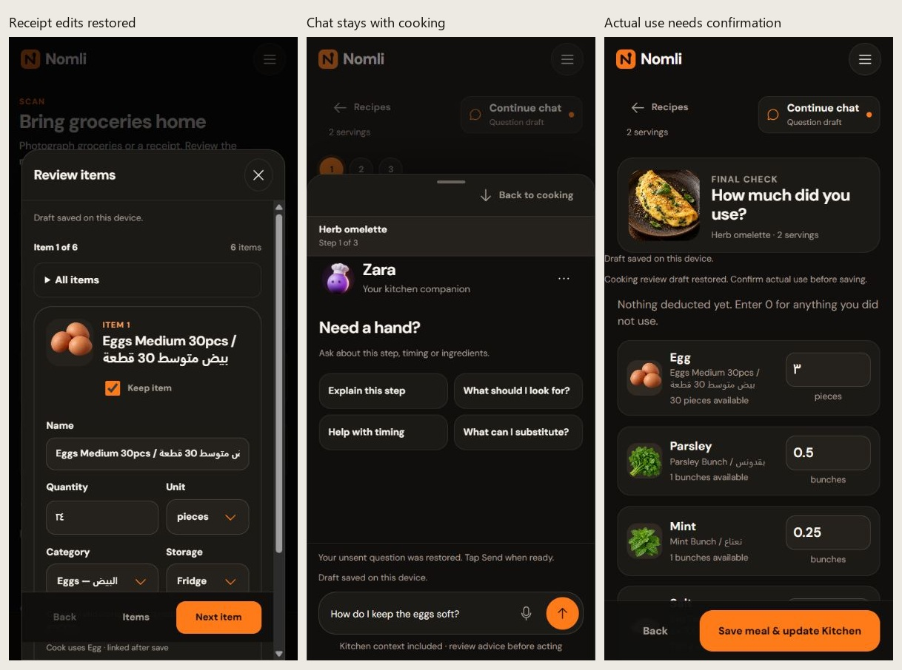

# M14 warm editorial redesign: verified

[Download Nomli-M14.apk](https://github.com/giza-maker/Artifact/releases/download/nomli-m14-v0.15.0/Nomli-M14.apk). Install over **Nomli Test** to retain inventory and connection settings. Version **0.15.0-m14**, code **23**; package `com.nomli.mvp.validation`; minimum Android API 26, target API 36.

Option 1's warm editorial style now covers Kitchen, scanning, recipes, preparation, cooking, Zara, dialogs and utilities. Kitchen groups inventory into eight browsable sections over the existing 32 categories. Its image rail scrolls horizontally; the whole top bar scrolls with the page; Add groceries stays reachable above navigation. Local photos keep priority over the 272 food illustrations.

Cooking uses its existing 60 distinct step visuals and animations, one progress indicator, focused controls, an in-step Zara panel and a meal-completion screen. Preparation and actual-use buttons enable after their required confirmations. Reviewed deduction, explicit undo, recipe identity matching, local photo privacy and M13 draft recovery remain intact.

485 tests, content/art/media validation, Vite build, Capacitor sync and [Android CI](https://github.com/giza-maker/Artifact/actions/runs/41085676206) passed. Source `1a5f43f351452a739f07b446203470ece0849aef`; CI wall time 1m 57s. Signed APK **95,876,272 bytes**; SHA-256 `73a2ef1c68efd86b63641a278d12ded58941951aef6f1bd87b395443f30859a8`. Retained certificate SHA-256 `8c02c3045c97327f5415451feb9ccb0db326322b90d460dde9f28a7c0b559ef0`; v2/v3 signatures, 16 KB alignment, ZIP CRC, all **231 bundled web assets**, configured-secret exclusion and QA-harness exclusion verified. Published asset size and digest match the verified local APK.

Browser checks covered 390×844, 320×640 and 320×568: all-category picker scrolling, Arabic inventory search, Arabic receipt quantity `٣٠`, six-card review and confirmed import, prep gating, three cooking steps, media pause, timers, Zara reply/return, actual use `٠٫٥`, atomic deduction, confirmation gating, explicit undo and completion navigation. Ordinary browser preview also loaded without console errors. [Design QA](../design-qa.md) passed; screenshots use synthetic inventory and controlled native/AI transport. Physical Android camera, microphone, keyboard, hardware Back and process-kill acceptance remain pending.


## Historical M13 interruption recovery: verified

[Download Nomli-M13.apk](https://github.com/giza-maker/Artifact/releases/download/nomli-m13-v0.14.0/Nomli-M13.apk). Package com.nomli.mvp.validation; version 0.14.0-m13, code 22; minimum API 26, target API 36. Install over Nomli Test.

Unfinished scan reviews recover edited fields, card position, source files and individual grocery crops from local private storage. Zara restores unsent or interrupted questions and waits for Send. Cooking review restores the entered amounts for the same session and requires fresh confirmation before deducting stock. Recovery never sends a question, imports items or deducts stock automatically. Scan fingerprints and cooking-session IDs prevent duplicate imports and deductions. Android saves drafts with atomic file writes; recovery excludes connection credentials and stays outside inventory backups. Bilingual receipt titles have room beside ingredient artwork, with Keep item below the title.

Removed crops stay removed after restart, and completed drafts clear. Failed snapshot writes leave the app responsive. Reset and backup replacement require a saved draft-clear record first. An eight-second timeout stops subsequent recovery writes until reopen. Unreadable drafts stay untouched until explicit discard; inventory remains available. Existing content is unchanged: 88 ingredients, 20 recipes, 272 food-art entries across 32 categories, 60 steps and 120 cooking-media files.

Source 9f5de2e6ca9260d6ce6f0830de4c9791eb2812ed; CI 41002753592 (4m 00s). 474 JavaScript tests, content/art/media validation, Vite build, Capacitor sync and Android compilation passed. APK 95,868,080 bytes; SHA-256 dee26cfea54e376ad11116e11ab93f04f25fbacdd09c3fcd49896b4ed7dc2657. Certificate SHA-256 8c02c3045c97327f5415451feb9ccb0db326322b90d460dde9f28a7c0b559ef0; v2/v3 signatures, 16 KB alignment, ZIP CRC and all 231 production assets verified. Configured secrets and QA harness absent. Published size/digest match local APK.

Browser QA covered the production build and actual Capacitor wrappers with controlled native transport at 390×844 and 320×568. Receipt quantity ٢٤ and wizard position restored after reload, confirmation reset, then 6 items and EGP 243.62 spending committed exactly once. A crop restored, and its later removal stayed removed. A pending Zara question restored with request count 1 and no resend; explicit retry produced a reply and cleared the draft. Arabic actual-use amount ٣ restored unchecked from its session allocation while egg stock stayed 30, then explicit confirmation deducted 3 to 27 and remained 27 after reload. A failed snapshot write left the UI responsive and blocked reset; an 8-second stalled write entered quarantine. A corrupt draft was discarded while stock remained intact. Protected deployed health passed in 544 ms; content responses were controlled fixtures, not live-model accuracy tests. Physical Android camera, microphone, keyboard, hardware Back and process-kill acceptance remain pending.

Recovery regression tests are included in the 474-test suite.



## Historical M12 kitchen-to-cooking experience — verified

[Download Nomli-M12.apk](https://github.com/giza-maker/Artifact/releases/download/nomli-m12-v0.13.0/Nomli-M12.apk). Package com.nomli.mvp.validation; version 0.13.0-m12, code 21; minimum API 26, target API 36. Install over Nomli Test.

Kitchen now gives empty inventory one Scan action and a secondary manual-add action; utilities sit under Kitchen tools. Ingredient entry starts with name, amount, unit and location, with expiry, photos, category and cooking details under More details. Inventory shows canonical food names while retaining original retail names. Arabic, Persian and English decimal quantities use the shared localized parser.

Cook has recipe search, All/Ready/Nearly-ready filters and readable photo cards. Items needing a measured weight are distinguished from missing ingredients. Recipe readiness and preparation come before calorie logging; all 60 steps can be previewed without changing stock. Successful scans return to Kitchen with a Find a meal action, while receipt spending remains recorded. Scan and Zara share one Connect Nomli setup; service address is advanced, a 10-second health check validates saves, and the selected Scan source type continues after setup. Zara offers local contextual next actions; prompts fill the question and still require explicit Send. Cooking chat remains an overlay over the unchanged cooking screen.

Source dd0ba48ee5c92372d3f2a7faea680f6c797fb413; CI 40988710065 (4m 39s). 441 JavaScript tests, content/art/media validation, Vite build, Capacitor sync and Android compilation passed. APK 95,855,875 bytes; SHA-256 895c89f0ce1dd1b16655b1e9146ce7694e2a22ef14b1dba413aa0338595efa6d. Certificate SHA-256 8c02c3045c97327f5415451feb9ccb0db326322b90d460dde9f28a7c0b559ef0; v2/v3 signatures, 16 KB alignment, ZIP CRC and all 232 production assets verified. Configured secrets and QA harness absent. Published size/digest match local APK.

Browser QA covered the production build and actual Capacitor wrappers with controlled native transport at 390×844, 320×568 and 320×360. Verified Arabic manual add and automatic identity matching; recipe search focus and availability filters; read-only step previews; preparation and cooking; delayed Zara reply across sheet dismissal with no abort; actual-use edit 4→3 preserved through chat; exact 3-egg deduction and guarded undo preserving the independently added apple. Reviewed six bilingual receipt cards, saved EGP 243.62, returned to Kitchen, and followed Find a meal. Unknown herb weights appeared as two amount checks; explicit test measurements entered with Arabic and English digits unlocked preparation without changing stock. Also verified shared setup and source continuation, advanced category Arabic search and return focus, scrolling/visible Save at 320×360, reachable chat composer, and calorie-entry access. Protected deployed health endpoint passed in 471 ms; scan/assistant content responses were controlled fixtures, not new live-model accuracy tests. Physical Android update, microphone, camera/QR, keyboard and hardware Back remain pending.

441 checks include 20-recipe/60-step preview coverage. The calorie diary, reviewed stock deduction/undo, local food art/media and deployed scanner/assistant Worker remain available.

## Historical M11.2 cooking chat sheet — verified

[Download Nomli-M11.2.apk](https://github.com/giza-maker/Artifact/releases/download/nomli-m11.2-v0.12.2/Nomli-M11.2.apk). Package com.nomli.mvp.validation; version 0.12.2-m11.2, code 20; minimum API 26, target API 36. Install over Nomli Test.

Zara opens as a chat sheet over preparation, the active cooking step and actual-use review. The cooking screen stays mounted behind it. The sheet shows the recipe, current phase and running or finished timer; Back to cooking, backdrop and Back dismiss it without changing the step.

Replies, voice controls and nested settings reuse the existing assistant. Chat rerenders never rebuild the underlying cooking form. Closing the sheet retains typed drafts, saved exchanges and pending replies, stops voice capture, restores focus and resumes cooking media according to the previous playback intent. Settings unwind before the sheet on Back; navigating to the full assistant closes the sheet. Drafts and unsaved actual-use edits survive navigation, but are not promised across a full app restart.

Source 199d7786c0c21fdc29f34a80e74cf80d0fd1efb9; CI 40967546204 (2m 50s). 412 JavaScript tests, content/art/media validation, Vite build, Capacitor sync and Android compilation passed. APK 95,847,683 bytes; SHA-256 3a5e4a7ff7512a4e2761cd33700429f233803bf9a28f538e6dfffa741b23f522. Certificate SHA-256 8c02c3045c97327f5415451feb9ccb0db326322b90d460dde9f28a7c0b559ef0; v2/v3 signatures, 16 KB alignment, ZIP CRC and all 232 production assets verified. Configured secrets and QA harness absent. Published size/digest match local APK.

Isolated browser/native-bridge QA at 390×844 and 320×360 verified preparation selections, Arabic drafts, delayed replies without abort, nested settings and Back, voice cancellation, full-assistant route changes, reachable composer actions, no horizontal overflow and focus restoration. A real one-minute timer expired while the sheet stayed open with the typed draft and focus intact. An edited egg quantity of 3 survived reply completion and sheet dismissal in final review without deducting stock. Controlled assistant responses and synthetic native transport were used; physical Android microphone, keyboard, hardware Back and update installation remain unverified.

The calorie diary, stock deduction/undo, 60 cooking demonstrations and deployed scanner/assistant service remain unchanged.

## Historical M11.1 cooking and Zara continuity — verified

[Download Nomli-M11.1.apk](https://github.com/giza-maker/Artifact/releases/download/nomli-m11.1-v0.12.1/Nomli-M11.1.apk). Package com.nomli.mvp.validation; version 0.12.1-m11.1, code 19; minimum API 26, target API 36. Install over Nomli Test.

Zara now shows an explicit Resume preparation, Resume cooking or Resume review button with the current recipe and step. Every cooking phase has a chat shortcut; active steps also show Continue chat. Returning to an existing exchange keeps the question instead of seeding a new step prompt.

Cooking/chat round trips preserve pending replies, including browser Back. Duplicate history events no longer cancel requests. Replies arriving during cooking update only chat controls, keeping timer/preparation/review fields intact; persistence restores focus to the active field. Opening chat clears its reply-ready indicator. Voice capture stops on navigation. Unrelated navigation and cooking mutations still cancel pending requests so stale advice cannot apply.

Source 6cd4850be1b5914fd4729513b3ff3ecb52900260; CI 40956619985 (4m 40s). 408 JavaScript tests, content/art/media validation, Vite build, Capacitor sync and Android compilation passed. APK 95,843,587 bytes; SHA-256 fbe290595f0f24cd119385805a3b5bfe92f38aca1f6d6301bd6628bd6c61b9b7. Certificate SHA-256 8c02c3045c97327f5415451feb9ccb0db326322b90d460dde9f28a7c0b559ef0; v2/v3 signatures, 16 KB alignment, ZIP CRC and all 232 production assets verified. Configured secrets and QA harness absent. Published size/digest match local APK.

390×844 and 320×568 browser/native-bridge QA verified the original abort, explicit return controls, bilingual unsent draft retention, pending replies through both Resume and browser Back, saved conversation reopening, background reply completion with timer field value 7 and focus retained, running timer continuity, read-indicator clearing, step-change cancellation, scrolling and no horizontal overflow. Synthetic native transport and a controlled delayed assistant response were used; no live AI or physical phone was used for this flow. Physical Android update/hardware acceptance remains pending.

The calorie diary, stock deduction/undo, 60 cooking demonstrations and deployed scanner/assistant service remain unchanged.

## Historical M11 calories — verified

[Download Nomli-M11.apk](https://github.com/giza-maker/Artifact/releases/download/nomli-m11-v0.12.0/Nomli-M11.apk). Package com.nomli.mvp.validation; version 0.12.0-m11, code 18; minimum API 26, target API 36. Install over Nomli Test.

Calories now has an offline daily food diary, explicit portions eaten, dated history, editing/removal and an optional user-entered goal. Kitchen includes a daily shortcut. Arabic, Persian and English numerals work; fractional portions are supported and ambiguous grouping is rejected.

Recipe pages show estimated kcal per serving and the total for the selected recipe size. A documented subset of 54 USDA SR Legacy references covers 17 of 20 recipes completely. Three recipes with labneh, zaatar or mixed-spice blends remain visibly incomplete and offer manual calorie entry. Generic references, portion weights and preparation states are documented in docs/NUTRITION.md; brand labels take precedence when entering packaged food.

Cooking does not mean eating: food logging never changes stock or spending, and cooking/stock undo never changes the food diary. Entries retain their original per-portion calorie snapshot. Diary and goal are included in local backups and excluded from Zara context. Existing inventory, photos, connection and step-specific cooking media remain available.

Source cad37f56e4fe0849bf1d7e4fb1a038b461800df6; CI 40945088800 (4m 17s). 403 JavaScript tests, content/art/media validation, Vite build, Capacitor sync and Android compilation passed. APK 95,839,491 bytes; SHA-256 8b7fb1cb983faef90a4d8a9fffd99d9d90b6365246b7e89d3fbf04a22e1a7d70. Certificate SHA-256 8c02c3045c97327f5415451feb9ccb0db326322b90d460dde9f28a7c0b559ef0; v2/v3 signatures, 16 KB alignment, ZIP CRC and all 232 production assets verified. Configured secrets and QA harness absent. Published size/digest match local APK.

Production browser QA at 390×844 and 320×568 verified Arabic calorie entry, fractions, invalid-input errors, goal set/remove, dated edits, recipe picker search, recipe scaling, incomplete-estimate manual entry, deletion, reload persistence, scrollable forms, focus restoration and no horizontal overflow. Console errors: none. Tests used an isolated local origin and synthetic food entries; no live nutrition/AI service or phone was used. Physical Android update acceptance remains pending.

Scanner/assistant Worker unchanged. All 60 cooking-step demonstrations remain bundled.

## Historical M10 step demonstrations — verified

[Download Nomli-M10.apk](https://github.com/giza-maker/Artifact/releases/download/nomli-m10-v0.11.0/Nomli-M10.apk). Package com.nomli.mvp.validation; version 0.11.0-m10, code 17; minimum API 26, target API 36. Install over Nomli Test.

All 60 steps across 20 recipes now show the current cooking action, with a distinct poster, motion and an observable Look for cue. The offline set contains 45 silent five-second clips and 15 four-frame illustrated sequences. New replacement images were generated with the built-in image generator; usable completed clips were retained as requested. Incorrect ingredient forms, preparation stages and layering were corrected before packaging. Active steps no longer repeat the finished-dish photograph.

Pause/replay works independently of the cooking timer. Media pauses off-screen, behind dialogs and in the background; a manual pause survives timer changes and returning to the same step. Reduced-motion settings show a still until explicit playback. Media never advances the recipe or changes inventory. Preparation, reviewed deduction, undo, Zara and scanning remain available.

Source 0ec1e932013e7f7671c425bfe7b336c2b2ff8a83; CI 40936298448 (3m 53s). 374 tests, content/art/media validation, Vite build, Capacitor sync and Android compilation passed. APK 95,831,299 bytes; SHA-256 b0928762eb8d62f5e3d1ce4d6da4a3f7aca7dce397fbeb807f6e9f9a477fbedb. Certificate SHA-256 8c02c3045c97327f5415451feb9ccb0db326322b90d460dde9f28a7c0b559ef0; v2/v3 signatures, 16 KB alignment, ZIP CRC and all 232 production assets verified. Configured secrets and QA harness absent. Published size/digest match the local APK.

390 × 844 and 320 × 568 browser/native-bridge QA verified local silent playback, illustrated-frame progression, pause across dialogs and timer rerenders, off-screen pause, scrolling, step navigation, required preparation, actual-use review, exact six-item deduction and undo. All 60 source visuals received review; 15 inaccurate scenes were replaced. All 45 retained clips decoded fully without errors. Camera/native transport was synthetic. Physical Android playback and update acceptance remain device checks.

All 120 media files (25,350,103 bytes) are bundled. Prompts and provenance: web/public/media/cooking/MANIFEST.json and content/cooking-sequences.json. Scanner/assistant Worker unchanged.

## Historical M9 guided cooking — verified

Cooking had compact text and dominant timer/review forms. The active task now has a large instruction card, visual context and persistent next action.

Cooking now has visual ingredient preparation cards, readable 20px instructions, prominent action titles, dish photography, numbered progress and heat cues. Optional timers use recipe-stated presets or your own duration and start only on tap. Read step uses the phone’s configured speech service, with Stop reading and cleanup on step changes, navigation, dialogs and backgrounding. Ask Zara prepares a current-step question; only Send shares it. Final review keeps editable actual-use amounts, one confirmed stock update and undo.

Timer rollback recovery preserves alert ownership after failed saves; restoration failures show a foreground-countdown warning.

Source 23d58f76ec11f854a828f871c40093b5aae54724; successful CI 40796074798 (4m 22s). All 350 JavaScript tests, content/art validation, Vite build, Capacitor sync and Android compilation pass. APK 70,402,992 bytes; SHA-256 542756b11ea90589866cdd88cb3384e7413363dbb23c538249f5deee055d6c2c. Retained certificate SHA-256 8c02c3045c97327f5415451feb9ccb0db326322b90d460dde9f28a7c0b559ef0; v2/v3 signatures, 16 KB alignment and ZIP CRC verified. All 111 production web assets match local dist; two empty Cordova placeholders expected. Configured secrets and QA harness absent. Published size/digest match local APK.

Browser QA at 390 × 844 and 320 × 568 verified readable instructions, reachable sticky controls, scrollable ingredients/review, no horizontal overflow, preparation confirmations, timer start/pause/reload, next/previous steps, overview dialog, Zara draft/return, final confirmation, exact six-item deduction and undo. Production Capacitor wrappers and Android bridge used synthetic native transport, including explicit speech stop, step cleanup and a retryable speech-engine error. The bilingual Carrefour fixture used synthetic measured herb weights (30 g/bunch and 20 g/bunch), never inferred in production. Reduced-motion rules were reviewed. Physical Android TTS quality, hardware/lifecycle and update acceptance remain phone checks.

Scanner/assistant Worker d3b10002-0f5c-45f7-ae0f-afe19040bd65 remains unchanged.

## Historical M8.4 exact bilingual receipt — verified

The supplied Carrefour receipt exposed the actual M8.3 failure: English and Arabic halves were normalized into one unknown phrase. Retail word orders and Bunch labels also lacked exact forms. All six saved names failed automatic linking despite valid quantities. Herb bunches additionally have no known gram weight; that is a distinct conversion requirement.

Every explicit bilingual clause must resolve to the same cooking ingredient. Curated retail word orders, bunch packaging, localized digits and full compact forms now match; conflicting descriptions, unknown brands and preparation/formulation ambiguity do not auto-link. Existing clear unlinked stock repairs on startup or confirmed restore without rescanning. Quantities, receipt finance, explicit opt-outs, valid manual identities and frozen allocations remain protected.

Recipe rows show herb bunches as present with weight needed instead of falsely describing them as absent. A compact Enter weight dialog accepts measured grams per unit using Arabic or English digits, revalidates the item snapshot and saves only gramsPerUnit. Active allocations cannot be changed. Measurement-only shortages stay out of shopping; duplicate review panels are removed. Salt can use canonical salt artwork despite an old condiment shelf category, without rewriting that category.

Source dfb250b0086eb2b694a79648ff1909a21ce386de; successful CI 40744969784 (2m 57s). All 321 JavaScript tests, content/art validation, Vite build, Capacitor sync and Android compilation pass. APK 70,390,704 bytes; SHA-256 d6b1fd4da3a6803fc0e03a7a634ee207676283470dfba1400b7f62df248d892d. Retained certificate SHA-256 8c02c3045c97327f5415451feb9ccb0db326322b90d460dde9f28a7c0b559ef0; v2/v3 signatures, 16 KB alignment and ZIP CRC verified. All 111 production web assets match local dist; two empty Cordova placeholders expected. Configured secrets and QA harness absent. Published size/digest match local APK.

390 × 844 browser QA used production Capacitor wrappers and the actual Android bridge with synthetic native transport. The exact six bilingual receipt lines imported without manual identity selection; confirmed spending remained EGP 243.62. Eggs, salt, ground pepper and oil immediately covered the omelette. Parsley and mint each showed one bunch in Kitchen with weight needed. Synthetic measured test values 30 g/bunch and 20 g/bunch, entered using Arabic and English digits, enabled preparation. Final review deducted 4 eggs, 0.5 parsley bunch, 0.25 mint bunch, 2 g salt, 1 g pepper and 10 ml oil; undo restored all original quantities. Unlinked saved inventory and confirmed backup restoration repaired all six names. Salt artwork was corrected. Utilities showed v0.9.4. No console errors or horizontal overflow; lower panels remained scrollable. Camera, storage and backup selection were simulated. Physical update/hardware acceptance remains a phone check.

Scanner/assistant Worker d3b10002-0f5c-45f7-ae0f-afe19040bd65 remains unchanged.

## Historical M8.3 recipe stock review — verified

M8.2 display-category gating could reject an exact food identity (Eggs under Dairy/Other), Arabic packaging normalization differed from display normalization, backup restore skipped repair, and all active cooking previously blocked synchronization. These code counterexamples were reproduced; the latest reported physical-phone case remains unverified without its installed version and exact item/recipe data.

Unique strict food names now establish cooking identity independently of shelf category. Arabic ة/ه and hamza variants normalize consistently in names and packaging words. Backup replacement repairs clear links inside the confirmed transaction. Active cooking freezes only allocated stock; other lots can repair, with deferred repair after completion/cancellation.

Missing recipe requirements now show matching Kitchen candidates and the specific unlinked, opt-out, unit, recorded-date or conflicting-identity reason. Compatible candidates offer explicit Use as confirmation, with live-state revalidation and no quantity change. Unsupported processing/formulation, expired lots, incompatible units, frozen allocations and existing conflicting identities go to item review. No weights, expiry or dietary facts are inferred.

Source f24a86941ce5ec872736722dfd883070343079d3; successful CI 40731042743 (5m 30s). All 310 JavaScript tests, content/art validation, Vite build, Capacitor sync and Android compilation pass. APK 70,390,704 bytes; SHA-256 4496b07d76b854214e122d34d6b7460b5564652fc122cbe973b63324449f79eb. Retained validation certificate, v2/v3 signatures, 16 KB alignment and ZIP CRC verified. All 111 production web assets match local dist; two empty Cordova placeholders expected. Configured secrets and QA harness absent. Published size/digest match local APK.

390 × 844 browser QA used production Capacitor wrappers and actual Android native-bridge.js with synthetic native transport. Eggs Medium 30pcs counted under Dairy. Unknown Brand Eggs 30pcs showed a recipe match; Cancel left it missing, confirmation supplied 4 recipe eggs without changing the saved 30 pieces, and reload retained the link. Synthetic backup restoration produced a linked بيض متوسط ٣٠قطعه item under Other before any restart. A linked parsley bunch showed Quantity units need review; entering a synthetic measured 30 grams per bunch covered the 15-gram requirement. Utilities showed v0.9.3. No console errors or horizontal/modal overflow. Camera, storage and backup selection were simulated. No Android device was connected for hardware verification.

Scanner/assistant Worker d3b10002-0f5c-45f7-ae0f-afe19040bd65 remains unchanged.

## Historical M8.2 Kitchen/Cook synchronization — verified

Display categoryId was saved while canonical ingredientId stayed empty. Cook allocates exact ingredient IDs, so 30 Eggs Medium 30pcs were invisible to the four-egg recipe. Retail descriptors/plurals also prevented suggestions. Strict shared identity matching now supplies editable clear matches and repairs existing clear stock after successful persistence.

Clear product names such as Eggs Medium 30pcs, Bell Peppers, Carrots Tray, zucchini/courgette and Arabic equivalents now prefill editable cooking links. All 272 food types declare a nullable canonical mapping; 63 have direct compatible mappings, and all 88 primary canonical English/Arabic names resolve under shared display categories. Artwork aliases alone never establish identity. Ambiguous formulations, preparation states, species and unknown brands stay for review; no grams, expiry or dietary facts are inferred.

Startup repair skips active cooking, preserves valid manual links and opt-outs, and swaps displayed state only after successful persistence. Unit conversion, expired-stock exclusion, atomic deduction, replay and undo keep their existing checks. Native write timeouts quarantine further writes until reopen because the late write outcome may be unknown.

Source 1116c9e9c16674df3b6d92ff93cdd822f708cdaa; successful CI 40633270436 (4m 28s). All 294 JavaScript tests, content/food-art validation, Vite build, Capacitor sync and Android compilation pass. APK 70,386,608 bytes; SHA-256 78a8f11be7aa9338cd0a0766af71e2116bb016dbbaf768e115336d05988af80e. Retained validation certificate, v2/v3 signatures, 16 KB alignment and ZIP CRC verified. All 111 production web assets match local dist; two empty Cordova placeholders expected. Configured secrets and synthetic QA harness absent. GitHub asset size/digest match local APK.

390 × 844 browser QA used production native wrappers, actual Capacitor Android native-bridge.js and synthetic native transport. Startup repaired nine clear unlinked items; herb omelette requirements showed exact Kitchen coverage. Full preparation/cooking/review deducted eggs 30→26 pieces and Undo restored 30; reload retained links and amounts. New receipt cards prefilled Egg, Bell pepper and Carrot; changing the name to Chocolate milk cleared stale Egg identity. Explicit Carrot unlink remained unlinked after saving/reload. The same new scan supplied the recipe eggs without a manual ingredient selection. A stalled Preferences.set exited loading after eight seconds with an original-inventory/reopen message. No console errors. Native camera/storage were simulated; physical Android install, permissions and hardware remain phone checks.

Scanner/assistant service remains the verified Worker d3b10002-0f5c-45f7-ae0f-afe19040bd65; API contracts and credentials are unchanged.

## Historical M8.1 supermarket artwork

Source ed456aefcbb4588292d37ecde0b442b7fec8a504; successful CI 40628893894 (3m 45s). All 268 JavaScript tests, content and food-art validation, Vite build, Capacitor sync and Android compilation pass. APK 70,382,512 bytes; SHA-256 eae8f012157cbbfc71d2de6fd975ce774ae591702e10e5ec2db98c0752d6799b. Retained validation certificate, v2/v3 signatures, 16 KB alignment and ZIP CRC pass. All 111 production web assets match local dist; two empty Cordova placeholders expected. Configured secrets and QA harness absent. Published asset size/digest match local APK.

Catalog checks cover 272 unique foods, 17 exact row-major 4 × 4 sheets, 32 compatible categories, all 544 primary English/Arabic names through category inference and artwork matching, alias ambiguity, regional names, compound names, category overrides and safe URLs. Asset validation checks local WebP headers/dimensions and occupied cells. Packaging compared alpha bytes and visible pixels over black and white backgrounds with each generated original: identical.

390 × 844 browser QA used production Capacitor/native wrapper with actual Android native-bridge.js and synthetic Android transport. Five Arabic receipt cards resolved distinct rice, vermicelli, orzo, cola and lemon-lime soda art. Review saved five items and exact EGP 109.00; artwork persisted after reload. A confirmed local photo took priority after reload; removing it restored food artwork. All 32 category icons rendered in a searchable sheet with independent scrolling (514 px viewport, 1722 px content). No horizontal overflow or console errors. Camera, storage and file selection were simulated; physical Android acceptance remains pending.

Live OCR regression fixtures passed: Arabic receipt SAR 23.00, English PDF AED 39.62 with AED 1.89 additional tax, and a two-product grocery photo with separate crop regions. Observed times 3.15 s, 3.64 s, 23.89 s; final deployed-service Arabic receipt replay 28.35 s. These observations are not latency or accuracy guarantees. Worker d3b10002-0f5c-45f7-ae0f-afe19040bd65 keeps receipt/grocery model separation, bounded fallback and the 32-category server allowlist. Gemini rejected the expanded nested enum with HTTP 400; its provider schema now accepts nullable text while the prompt lists choices and runtime validation converts unknown IDs to null. OpenAI strict schema retains the enum.

Full ImageGen prompts, cell maps, dimensions and SHA-256: web/public/images/food/atlases/MANIFEST.json. Illustrations never establish food identity, ingredients, allergens, weight or expiry and do not assign cooking links.

## Historical M8 card review and food categories

Source 6dcfa83eaf9c91ef5580b9fc170dd83d56aad669; successful CI 40620367726 (4m 42s). All 248 JavaScript checks, content validation, Vite build, Capacitor sync and Android compilation pass. APK 46,025,882 bytes; SHA-256 634296f40af4c298e482043afa62c66135cd33bbecf2151bb31b0f245fcdbfca. Retained validation certificate, v2/v3 signatures, 16 KB alignment and ZIP CRC pass. All 92 production web assets match local dist; two empty Cordova placeholders expected. Configured secrets and QA harness absent. Published asset size/digest match local APK.

390 × 844 browser QA used actual Capacitor core/Android native-bridge.js and production native wrapper with synthetic Android transport. Back preserved Arabic quantity edits; skip saved four selected items with spending excluded; full review saved five items and exact EGP 109.00. Repeating that source was a no-op. Categories and an uploaded local photo survived reload; the photo hid category artwork. Category picker displayed all 16 food icons and scrolled. Grocery crop selection updated the card photo immediately; removing it restored the category icon. Advanced card content scrolled (622 px viewport, 1488 px content) without horizontal overflow. No console errors. Camera, plugin storage and file selection were simulated.

Live production OCR returned editable categories for an Arabic receipt PNG (SAR 23.00), an English PDF (AED 39.62 with AED 1.89 additional tax) and a two-product grocery image with individual crop regions. Categories included vegetables, dairy, legumes, condiments and oil. Observed times: 17.33 s, 6.89 s, 4.34 s. These are fixture observations, not latency or accuracy guarantees. Worker c5dfb215-9db7-4761-ab67-a369d62f9234 retains receipt/grocery model separation and bounded fallback.

Tests cover one-item review state, navigation/edit invalidation, 0/500-item bounds, localized quantity/money, unknown excluded costs as null, optional category persistence/backup, safe merges and replay. Scan categories are an opt-in capability; legacy clients retain their original response shape. No provider assigns canonical cooking IDs or storage. Broad category and editable storage suggestions are applied only through final human confirmation.

Original phone screenshots guided the redesign. Final browser checks used synthetic receipts and plugin transport; no physical Android interaction is claimed. ImageGen produced one transparent category atlas; asset and prompt provenance are in web/public/images/food/ASSETS.md.

## Historical verification

# M7.2 receipt recovery and bilingual input — verified

APK source bd68c5fb2ec1b82ba03ccb8206a0b3363adbc65b; CI 40604058146 (3m 53s), including 218 JavaScript checks. Final scanner source bb7e473361ce39e9dec7595d093823254e6bfd2d; 225 JavaScript checks pass locally after routing/fallback changes. Content validation, Vite build, Capacitor sync and Android compilation pass. APK 43,891,693 bytes; SHA-256 e4c41e43f66046e835b9be923e43ed6a957018ddba8664b77836995b71eced50. Retained signing certificate, v2/v3 signatures, 16 KB alignment and ZIP CRC pass. All 90 production web assets match local dist; two empty Cordova placeholders expected. Configured secrets and QA harness absent. Published asset size/digest match local APK. Server-only routing/fallback changes do not alter bundled client assets.

Four synthetic bilingual receipts passed production OCR: Arabic/English labels and Arabic/Persian/ASCII numerals, in PNG and one-page PDF. All returned SAR 2300 minor units, zero additional tax/discount, 1.5 kg tomatoes and 2 L/2000 ml milk, with the printed date. Observed times: 3.83 s, 3.78 s, 13.64 s, 3.50 s. Two existing AED receipt fixtures and grocery image regions also passed via the real scan client with exact-file fingerprint validation. These are fixture observations, not latency guarantees or proof for the user's original receipt.

390 × 844 browser QA used actual Capacitor core/Android native-bridge.js and production native wrapper with synthetic Android transport. Arabic/Persian receipt edits saved exact SAR 23.00 and two inventory lines, retained after reload. Malformed grouping blocked with field focus; retry reused the same source; cancel left saved inventory unchanged. Long review panel scrolled (622 px viewport, 3229 px content), with no horizontal overflow or console errors. Device picker, camera, storage and speech were simulated.

The initial Gemini 3.5 production PNG/PDF calls timed out after approximately 60 seconds; identical PNG later completed in 3 seconds. Direct Arabic extraction on Gemini 3.1 completed correctly in 2.27 seconds. Worker 9f0404b5-624a-4e09-b49f-f63a462d0ce4 uses Gemini 3.1 for receipts; Gemini 3.5 for grocery/expiry scans, receipt fallback and the existing assistant. No image downsampling or fingerprint protocol changes were introduced.

Tests cover timeout recovery, one fallback maximum, no retry for quota/auth/schema/cancel, deadline exhaustion and late responses, redirect rejection, log privacy, localized exact money and commit/save/reload/replay. Only timing, status and whitelisted token metadata reach scanner logs; receipt contents and credentials are excluded. Cloudflare incoming request cancellation is enabled explicitly.

Numeric support applies to receipt review and cooking-link weights; it is not a complete Arabic translation of every app screen. Ambiguous comma-only values are rejected for correction. No live receipt writes inventory or spending without confirmation. Original receipt and physical phone update remain unverified.

## Historical verification

# M7.1 plugin-loading hang — fixed and packaged

Reproduced production native.js against the actual installed Capacitor dependency, with only native transport simulated. Preferences roundtrip passed; photo save, voice status and backup export never settled. No native method was dispatched. Capacitor generated UNIMPLEMENTED errors for NomliScan.then, NomliVoice.then and NomliBackup.then.

Cause: async loaders resolved Capacitor proxies directly. Their dynamic then method triggered Promise assimilation without settling the outer promise. Loaders now resolve plain {plugin} handles and unwrap proxies synchronously. Shared caching prevents duplicate registration.

New regression fails before fix and passes after, exercising actual production loaders, photo save/get/remove/clear, picker, voice status and backup export/import. Voice proxy tests reject malformed handles and assert no then reads. All 204 JavaScript tests and content checks pass. Real-bridge browser QA passed plain/photo add, crop, save/reload with native getItemPhoto, voice start/finish/review and backup callbacks. No pending operations or console errors. Device camera/speech/storage were simulated.

Source 7c7e3fd27a79525b29815877f0deb49dc815018d; successful CI 40597589060 (4m 19s). 204 JavaScript tests, content validation, build, Capacitor sync and Android compilation pass. APK 43,891,693 bytes; SHA-256 ae8a476b2c2c82061d65e2153851c0fa84a4a13dc2c7b1eb0c3e5c276fcb3d10. Retained signing certificate, v2/v3 signatures, 16 KB alignment and ZIP CRC pass. All 90 production web assets match; two empty Cordova placeholders expected. Configured secrets and QA harness absent. Published size/digest match local APK.

## Historical M7 evidence

# M7 verification — 28 October 2026

200 JavaScript tests pass; content validation passes for 88 ingredients, 20 recipes, 3 receipt fixtures. Added photo ID/source/storage-boundary and grocery-only attachment tests; assistant context excludes local photo references.

Browser evidence at 390×844 and 320×640: manual photo save/reload; grocery review/save/reload with persistent JPEG thumbnail; live inventory search preserving focus; nested searchable selector and focus return; all 20 recipe cards mapped; new detail art loaded; chronological chat, pending/retry and live Zara reply (800 ml milk for four servings); synthetic speech review and separate Use/Send; short-screen voice drawer scrolling with composer/navigation visible.

Additional crop evidence: real protected grocery recognition returned separate normalized regions for Tomatoes and Basil in a synthetic two-food composition. Browser adjusted and reopened a crop, retained reviewed fields/focus, saved two distinct 256×256 JPEGs, and reloaded both under different local photo IDs. Crop geometry, ownership, compatibility and voice lifecycle tests bring total to 200. Worker image-region update deployed as b7c29c48-2561-470c-a00a-1228d932b61c; legacy request schema remains unchanged.

Voice hardening removes JavaScript cancellation during native permission UI and exempts permission-pending sessions from native stop cancellation. Native capture still cancels on actual pause/stop; reviewed text clears when hidden. Bridge failure and missing speech-service errors are distinguished. Reported silent Speak behavior in the installed APK has not been reproduced here; phone retest remains required.

Local Node network requests timed out; Windows PowerShell network relay reached production successfully; the later region update preserved Zara behavior. Synthetic camera/speech bridges do not verify actual Android hardware. Built from `5e3fc5751c8d7e886d3c326956e62c38225df382` in successful [CI run 40591130479](https://github.com/giza-maker/Artifact/actions/runs/40591130479); Android job took 1m 42s. All **200 JavaScript tests**, content validation, production build, Capacitor sync and Android compilation pass. APK: **43,891,693 bytes**. SHA-256:

```text
67f155a30b769e17747ae4c170b1fb97f627969a68d7dbae9705c3e637e606bb
```

APK Signature Schemes v2/v3, 16 KB alignment and ZIP CRC pass. Certificate SHA-256: `8c02c3045c97327f5415451feb9ccb0db326322b90d460dde9f28a7c0b559ef0`, matching prior validation releases. All 90 production web assets match byte-for-byte; two empty Cordova placeholders are expected. Configured provider key/device code, private files and QA harness are absent. GitHub asset size/digest match local APK.

## Historical verification

## Milestone 6, 27 October 2026

- Source `d30cd583d40ccdb1c5ce6656d46a888d18f453f4`; all 171 JavaScript tests, content validation, build and Capacitor sync pass. [CI run 40549447675](https://github.com/giza-maker/Artifact/actions/runs/40549447675) succeeded; Android job took 2m 34s. Native Java compiled; no device runtime tests ran.
- APK 42,091,800 bytes; SHA-256 `2afe8e7eb19a4dd458b3a8396b9b2f22bb24985b91b919c290c5256a6325c2d8`. Published size/digest match. Package `com.nomli.mvp.validation`, version `0.7.0-m6`, code 7, minimum API 26, target API 36 verified with aapt2. Retained certificate `8c02c3045c97327f5415451feb9ccb0db326322b90d460dde9f28a7c0b559ef0`, v2/v3 signatures, 16 KB alignment and CRC pass. All 72 production web assets match; two empty Cordova placeholders expected. Configured provider key/device code, private files and synthetic QA harness are absent.
- Scan regressions reproduced inherited merge mapping/stock lookup and prototype mutation before own-property fixes. Full review→commit→cooking-link tests cover prototype-like and normalized IDs. Browser exposed repeated warnings from backend/client/app normalization; regressions also reproduced 101 warnings from 97 retained provider messages plus four diagnostics. Deduplication reserves diagnostic capacity and stays stable on repeated review. Both actual live scan results remain stable through repeated normalization.
- Native notification regressions reproduced lost alert IDs on failed cancellation/cleanup. IDs now remain retryable. A tested transition helper retires changed timer ownership before replacement persistence, with rollback on failure and no nested save. Android backup export now resolves after resources close, so provider close errors reject. This Java change has compilation/code-review evidence only.
- Browser used five explicitly linked synthetic stock lots and simulated camera/picker/microphone/notification methods. Bilingual oats edit converted 500 g to 0.5 kg and survived reload. Ingredients-only filter returned the stocked recipe. Four-serving preparation required five ingredient checks and tool confirmation; partial checks survived reload. Planned quantities remained oats 200 g, milk 800 ml, dates 160 g, cinnamon 2 g and almonds 50 g.
- Injected native cancellation failure blocked step advancement, retained step 1 and running deadline through reload, and allowed retry to step 2. Timer continued across Zara navigation and later expired. Simulated Arabic capture required Use and separate Send; no automatic call occurred. A browser send through the local QA relay failed safely, preserving typed text; its cause was not established. A separate direct production call with the same kg-based cooking context succeeded in about 19.5 seconds: Arabic step 2, oats 0.2 kg/200 g, no proposals. An independent deployed quantity proposal and unauthorized request check passed. No production Worker code/configuration was changed or redeployed.
- Browser confirmed actual use oats 0.18 kg, milk 800 ml, dates 18 pieces, cinnamon 0 g and almonds 50 g. Reload retained 0.32 kg, 200 ml, 2 pieces, 10 g and 50 g. After almonds top-up to 60 g, undo/reload restored 0.5 kg, 1,000 ml, 20 pieces, 10 g and 110 g. Automated tests cover replay/duplicate undo and stale proposals. Generic repeated same-ingredient mixed count/mass allocation can report a false shortage; none of the 20 curated recipes has repeated ingredient IDs, so current UI cannot create that case. Allocator changes were deferred to preserve expiry ordering.
- Fresh production synthetic PNG/PDF scans returned chickpeas 1,600 g, tahini 500 g, oil 1 L, AED 39.62 total, AED 1.89 added tax and zero discount; expiry stayed unknown. Observed times about 19.2 and 3.6 seconds are fixture observations only. Browser replayed the actual PNG result, verified failed scan leaves stock unchanged, reviewed storage, scrolled to lower confirmation controls, saved eight total stock entries and AED 39.62 spending, then exported/restored backup and reloaded. Native file operations were test doubles. Screenshots saved locally as `.tools/qa/m6-receipt-review.png` (before warning deduplication) and `.tools/qa/m6-inventory-after-restore.png`; desktop 430 px shell only, not physical-device or verified narrow-viewport evidence.
- Runtime `npm audit --omit=dev` reported zero known vulnerabilities at this checkpoint. No phone or emulator connected. Native microphone/permission/language quality, camera/QR/SAF, Android background notifications, keyboard/RTL accessibility, force-stop persistence and update installation remain pending in [TESTING.md](TESTING.md). Accounts, barcode product lookup, cloud sync, learning and gamification remain outside this milestone.

## Milestone 5, 27 October 2026

- Source `aae7375b35563ba5dbc5945dca84e599333f1b36`; 161 JavaScript tests, content validation, production build and Capacitor sync pass. [CI run 40542738894](https://github.com/giza-maker/Artifact/actions/runs/40542738894) succeeded; Android job took 4m 08s. Native Java compiled successfully. No native audio or permission runtime tests ran.
- Verified APK: 42,091,800 bytes, SHA-256 `03a453d141a837c868b4cde1567a984cb166f8bbeb341901e24acc53f1926716`. GitHub asset size/digest match. Package `com.nomli.mvp.validation`, version `0.6.0-m5`, code 6, minimum API 26 and target API 36 verified with aapt2. Retained certificate `8c02c3045c97327f5415451feb9ccb0db326322b90d460dde9f28a7c0b559ef0`, v2/v3 signatures, 16 KB alignment and ZIP CRC pass. All 72 production web assets match; empty Cordova placeholders expected. Actual configured provider key and device code are absent. Test-only synthetic microphone and relay code are excluded from production assets.
- M5 uses Android's default SpeechRecognizer through the custom registered native plugin. The merged manifest contains RECORD_AUDIO, optional microphone hardware and RecognitionService visibility. Requested locales are en-US, ar-SA and ar-EG. No extra speech SDK, provider credential, downloaded media or account setup is added. Device speech-provider processing may require internet and send audio online.
- Thirteen controller and six bridge tests cover request identity, late results, cancellation during lazy loading/listener setup, stalled listener cleanup, timeouts, malformed results, errors and the 2,000-character bound. Native lifecycle/permission ordering received code review, not phone verification. Capture/review text stays ephemeral; explicit Use appends, separate Replace replaces, and separate Send invokes the unchanged M4 assistant contract. Voice never mutates inventory.
- Fresh local browser QA used an explicitly labeled synthetic microphone bridge with no audio capture and five linked stock lots. Arabic (Egypt) capture/review/edit preserved Arabic numerals and direction; appending retained the typed draft. Blank review blocked insertion. A 2,000-character transcript plus an existing draft produced an inline overflow error without truncation. Explicit replacement worked. AI-send counter remained zero until Send question.
- Simulated permission denial and unavailable service showed actionable typing fallbacks. A late result after Cancel was ignored; typed text remained. Navigation during capture cancelled it. Kitchen quantities remained oats 500 g, milk 1,000 ml, dates 20 pieces, cinnamon 10 g and almonds 100 g.
- After explicit Send, the production Zara service answered the current frozen cooking step: step 2, oats 200 g. No proposals appeared. Early local QA relay/network and compression failures preserved the question; correcting only the ignored test relay resolved the browser call. Production Worker/backend code and its deployed M4 version remain unchanged. No M5 Worker deployment was needed.
- Screenshot inspection covered the desktop 430 px phone shell and Arabic review controls; saved locally as `.tools/qa/m5-review-browser.png`. Browser speech results were synthetic, not actual recognition or physical-phone evidence. Keyboard/viewport behavior on a real device is unverified.
- No phone or emulator was connected. Actual microphone/permission flow, installed language support, noisy-kitchen quality, Bluetooth/call interruption, background microphone release, keyboard/RTL accessibility, camera/QR/SAF, notifications, force-stop persistence and update installation remain pending in the [voice acceptance checklist](VOICE.md). Barcode product lookup, accounts, cloud inventory sync, learning and gamification remain outside M5.

## Milestone 4, 27 October 2026

- Source `533ae81a1c8cfe75b843e8469b9fb884d69f6e7a`; 142 automated tests, content validation, production build and Capacitor sync pass. [CI run 40534182533](https://github.com/giza-maker/Artifact/actions/runs/40534182533) succeeded; Android job took 3m 48s.
- Verified APK: 42,067,224 bytes, SHA-256 `60ab9d70541ac11d7ddb395b9b456e22548af08230041636af8b057536b67943`. GitHub asset size/digest match. Package `com.nomli.mvp.validation`, version `0.5.0-m4`, code 5, minimum API 26 and target API 36 verified with aapt2. Retained certificate `8c02c3045c97327f5415451feb9ccb0db326322b90d460dde9f28a7c0b559ef0`, v2/v3 signatures, 16 KB alignment and ZIP CRC pass. All 72 production web assets match; empty Cordova placeholders expected. Actual configured provider key and device code are absent.
- Worker version `ffd601c0-918d-4537-a4f2-467d34c16294` adds authenticated `/api/v1/assistant-replies`, strict bounded context/replies, cancellation/deadlines and reviewed proposals. Existing encrypted Gemini credential and private device pairing are reused. Worker stores no conversation. Up to 20 exchanges persist locally; backups include them but exclude connection credentials.
- Node tests missed a Cloudflare-specific redirect incompatibility. Temporary metadata-only diagnostics identified rejection of `redirect: error`; a regression test reproduced it. Server now uses manual redirects and rejects non-2xx responses without forwarding provider credentials. Temporary diagnostics were removed. Deployed authentication and live quantity-proposal checks pass.
- Initial Gemini 3.1 assistant calls returned repeated 503 responses; a production scanner check also failed. Both paths now use Gemini 3.5 Flash-Lite. Four local-service live fixtures passed: exact four-serving inventory readiness; explicit oats correction from 500 to 350 g; opening a known recipe for four servings; Arabic current-step assistance without proposals. Those calls took about 2.8, 5.5, 20.1 and 5.1 seconds. These are fixture observations, not benchmarks or broad answer-quality guarantees.
- Fresh production PNG/PDF scans returned chickpeas 1,600 g, tahini 500 g and oil 1 L; AED 39.62 total, AED 1.89 added tax, zero discount and unknown expiry. Observed times were about 7.6 and 4.8 seconds. An earlier PNG run left discount unknown; an explicit printed-total/tax arithmetic instruction resolved this fixture. Review remains mandatory. Actual returned drafts passed storage review, atomic commit/save/reload, exact-file replay and backup roundtrip.
- Browser used a fresh synthetic origin with five explicitly linked lots. Cancel retained its draft; manual retry returned a live proposal. Confirmation was required; applying changed oats 500 → 350 g, retained after reload. Recipe proposal opened the already selected four-serving recipe, with no deduction and a matching URL hash. Stale and active-session proposal checks, failed-write retries and legacy state compatibility are covered by tests.
- Browser preparation froze four-serving allocations. At step 2, a running two-minute timer continued while Zara returned Arabic instructions with oats 200 g, milk 800 ml, dates 20 pieces/160 g, cinnamon 2 g and almonds 50 g. No proposals appeared. Return and reload restored step 2 and the remaining timer deadline. Local conversation persisted.
- Long conversation scrolled to its final controls while bottom navigation remained fixed. Screenshot inspection covered the existing 430 px desktop phone shell, not a physical phone or a verified 390 px browser viewport. Screenshot saved locally in `.tools/qa/m4-mobile.png`. Browser automation's viewport override failed and was not used as responsive-test evidence.
- Physical update installation, camera/QR/SAF permissions, native notifications, keyboard and force-stop persistence remain phone checks. Voice input, barcode product lookup, accounts and cloud inventory sync remain future work.

## Milestone 3, 27 October 2026

- Source commit: `08c8c47a300239e90f7b0c14ed077772246f34ea`. All 110 automated tests, content checks, production web build and Capacitor sync pass. [CI run 40516558999](https://github.com/giza-maker/Artifact/actions/runs/40516558999) succeeded. Verified APK is 42,063,128 bytes with SHA-256 `d0fb13d2a1c2cf5c954dd035cff22fc07a0cab700bfa1d802940fc7b49d0f1fe`. Published GitHub asset size and SHA-256 match the verified local APK.
- `aapt` verified package `com.nomli.mvp.validation`, version `0.4.0-m3`, versionCode 4, minimum API 26 and target API 36. APK Signature Schemes v2/v3, 16 KB alignment and ZIP CRC checks pass. Certificate SHA-256 `8c02c3045c97327f5415451feb9ccb0db326322b90d460dde9f28a7c0b559ef0` matches the retained validation certificate. All 72 packaged production assets match byte-for-byte; two generated Cordova placeholder files are empty. The configured provider key and device access code are absent from the APK.
- M3 uses 20 curated recipes and 88 ingredients. Explicit ingredient links and optional measured grams per count unit drive stock assessment, compatible conversion and earliest-expiry allocation. Catalog dietary filtering does not establish allergen-free food or cross-contact safety.
- Domain review fixed allocation across mixed units and rejection of recorded past-date stock when a resumed session records actual use. Notification review fixed cleanup after persistence failure and ordering around the local transaction. Native alert scheduling now captures the deadline before the permission prompt; this code fix has not been verified on a phone.
- Fresh-origin browser QA created five explicitly linked items: oats 500 g, milk 1,000 ml, dates 20 pieces with measured 8 g per piece, cinnamon 10 g and almonds 100 g. The date-oat recipe at four servings planned 200 g, 800 ml, 160 g, 2 g and 50 g respectively.
- Partial preparation checklist state survived reload. A running three-minute timer survived reload. Changing recipe servings to one during the active session left its frozen four-serving plan unchanged.
- Actual-use review recorded oats 180 g, milk 800 ml, dates 18 pieces, cinnamon 0 g and almonds 50 g. Save and reload retained stock quantities of 320 g, 200 ml, 2 pieces, 10 g and 50 g. After topping almonds up to 60 g, undo restored quantities to 500 g, 1,000 ml, 20 pieces, 10 g and 110 g, preserving the later 10 g top-up.
- Browser console reported no errors during these flows. Within a centered 430 × 900 app shell (not the actual browser viewport), DOM measurements showed a 742 px main region with 1,208 px of content and `overflow: auto`; lower Save and Undo controls were reachable. Chrome CDP screenshot capture failed, so this record makes no screenshot-based visual assessment.
- Final browser polish verified a custom timer value of 33 displays as 33, singular serving wording and readable allergen labels.
- The M2 protected Gemini Worker and private setup QR remain unchanged. M3 did not repeat the M2 OCR fixture checks; those checks were not an accuracy benchmark. Live Zara and voice integration remain M4 work.
- No physical-phone QA has run. Camera and QR permissions, native SAF picker, notifications, system keyboard, update installation and Preferences across force-stop remain device checks. Browser persistence and responsive DOM checks do not verify native runtime behavior.

## Milestone 2, 26 October 2026

- 69 automated tests pass. Coverage includes scan client validation, native picker handling, editable scan drafts, integer money, atomic local persistence, identical-file deduplication, configuration separation, backup behavior and server proxy boundaries.
- Package remains `com.nomli.mvp.validation`. M2 version is `0.3.0-m2` with `versionCode` 3.
- CI run [40361683245](https://github.com/giza-maker/Artifact/actions/runs/40361683245) passed in 4m 14s from source commit `2f3a51bc3e1634fca2c73c55613ceb977d5c1a6f`. The verified APK is 42,046,744 bytes with SHA-256 `5f288d5e016253a7302b4d6b444ec1a4a27c40250cf2f251186ccf20ee75c9e5`.
- APK Signature Schemes v2 and v3, 16 KB alignment and the retained M1 signing certificate were verified. All 72 production web assets match byte-for-byte; two generated Cordova placeholder files are empty as expected. The configured provider key and device access code are absent from the APK.
- Live Cloudflare endpoint `https://nomli-scan-proxy.ahmed-aljazayeerly.workers.dev` is deployed as Worker version `91f2ad3b-de56-4623-95f5-ec02f4542c7b`. Gemini 3.1 Flash-Lite credential is stored as an encrypted server-side secret and is absent from client configuration.
- Synthetic receipt PNG and PDF calls completed in about five and four seconds. Both returned the three expected items, chickpeas 1,600 g, tahini 500 g, oil 1 L, AED 39.62 total and AED 1.89 tax. An initial multipack extraction error was corrected with explicit printed-pack arithmetic instructions. These small fixture checks are not an OCR accuracy benchmark.
- Actual remote drafts were passed through mandatory storage review, atomic import, save/reload, identical-file replay and backup roundtrip. All passed. Local browser verified connection validation, readiness and source selection; native file selection and full phone scan flow remain device checks.
- A generated product-label image also passed live grocery and expiry scans: grocery produced 400 g without creating a phantom receipt; expiry produced `2026-12-31` without changing the existing quantity.
- Review supports corrections to quantity, unit, storage, date, merchant, currency, tax and discount before one atomic local save. Deduplication applies only to exact file bytes scanned under the same kind. A different photo of the same document is a new input.
- Scan connection configuration is separate from inventory backup data. Android supports a private setup QR that fills the connection form; the user must run the connection test and choose Save.
- Images are limited to 4 MiB. PDFs are limited to 2 MiB and three pages. The configured Cloudflare limiter allows approximately 10 scan requests per 60 seconds per Cloudflare location; it is not a hard billing cap.
- Inventory is offline. Recognition requires internet and sends selected files to Google through the Cloudflare proxy. The app does not retain uploaded file bytes after processing.
- No physical-phone QA has run. Native SAF picker behavior, camera permissions, Preferences across force-stop, keyboard behavior and update installation remain unverified on device.
- Live Zara, voice recognition, barcode product lookup and robust cooking behavior remain unimplemented. Accounts, cloud inventory sync and the documented multi-user server contract are future work.
- Gemini API quota depends on API account and billing state. A Gemini app subscription, including Ultra, does not by itself define free or paid API quota.

## Milestone 1, 26 October 2026

- 24 automated tests pass, including 12 storage tests covering empty state, migration, native Preferences precedence, failed writes, serialized saves, backup roundtrip, corruption recovery, unsafe fields, units and size limits. Content checks and production build pass; Capacitor sync includes four official plugins plus the custom registered Android backup plugin.
- Independent code review found and fixed restore/save ordering, failed-consumption success reporting, and malformed search backup fields. Controls lock while critical mutations persist; replacement joins the same save queue.
- Browser verified fresh empty state, ingredient creation, edit, 0.001 fractional display, optional expiry provenance and persistence after reload. Although browser download-event automation stalled, the actual exported JSON was found in Downloads and validated against the exact edited state. Browser upload automation requires an extension permission that was not changed; import picker use remains a phone test.
- Deletion survives reload. A 12-item inventory with Arabic text renders correctly; the last item can be opened after scrolling 979 px within the bounded main region while navigation stays fixed.
- M1 CI run 40342137040 passed. Published local-signed APK is 42,034,456 bytes; v2/v3 signature, 16 KB alignment and all 72 bundled production assets verified. GitHub release digest matches local SHA-256. Package/version identity recorded in `artifacts/build-status.json` and `docs/APK.md`.
- Android SAF file-picker runtime, native Preferences across force-stop, system keyboard and update installation require testing on a physical phone. Automated tests use storage doubles; APK signature checks alone do not establish these runtime behaviors.

Earlier prototype evidence below remains historical and does not imply that M1 enables sample scans.

25 October 2026.

- Production web build passes with pinned Vite/Capacitor packages.
- Nine domain tests pass: integer money, invalid/reserved IDs, compatible unit conversion, reviewed atomic receipt import, rollback on total/review failure, idempotency replay/conflict, aggregate cooking consumption, insufficient-stock rejection, and bounded assistant proposal schemas.
- Three native-notification lifecycle tests pass: replacement cancellation, late scheduling after pause, and web permission suppression. Total automated tests: 12.
- Content checks pass: 88 ingredient IDs, 20 recipe references/units and image files, three receipt totals in integer minor units.
- Runtime dependency audit reports zero known vulnerabilities at preparation time (`npm audit --omit=dev`).
- Browser verified at 320 × 740, 390 × 843 and desktop 1280 × 900: four main tabs, manual custom ingredient, staged paper receipt, edited line price and revised total, atomic stock/spending update and duplicate receipt block.
- All five scan variants reach their editable review form: fridge, barcode, expiry, paper, digital. Native camera and OCR are not exercised by these web tests.
- Long receipt panel measured 1,249px content in a 772px scrollable body; Close stays available. Inventory has its own bounded scrolling region.
- Recipe list/details, three cooking steps, elapsed-time timer across routes, Zara current-step answer, sample transcript review and ingredient consumption verified in browser. Receipt/cooking changes survive reload in local storage. No console errors observed during those flows.
- Synthetic digital receipt PDF rendered and visually inspected; PNG included beside PDF. Fixture has no printed expiry and matches its JSON ground truth.

Android compilation status is recorded separately in `artifacts/build-status.json` after setup. Web build and Capacitor sync do not by themselves prove native runtime behavior. No physical device was connected. Live auth, database, OCR, LLM, voice, concurrent updates and production security remain implementation/validation work.

Java 21.0.10, Android API 36 and Gradle 8.14.3 verified locally. APK compilation and package verification passed in CI; physical-device QA has not been run. Gradle may download Maven dependencies during the first build.

## Android APK build

- GitHub Actions run 40206456176 passed from source commit 87d90f8ed91388f3a3e3677bd1d1a1425fea5880.
- Package com.nomli.mvp, version 0.1.0-demo, minimum API 26, target API 36.
- APK: 42,023,655 bytes. Signature v2 and 16 KB ZIP alignment verified both in CI and locally.
- Downloaded CI archive digest and APK SHA-256 match; ZIP CRC checks pass. Every bundled web asset matches the local production build. No environment or private-keystore files are packaged.
- Physical-device camera, barcode, permission and timer testing remains pending.
