# NURIMI production commerce and repeatable brand launch decision

Research date: 27 October 2026. Saudi own-inventory retail; Arabic and English. Decision owner: NURIMI founding team. Prices are public list prices captured on this date unless explicitly labelled planning assumptions.

**Recommended route: Salla Pro with a vendor-supported, published Twilight theme and a controlled NURIMI design layer, subject to the merchant and platform proof below.** Keep checkout, payments, stock, orders and shipping inside the managed commerce platform. Build our reusable advantage in brand configuration, product information, visual production, quality checks and operating procedures. Run each distinct retail brand as a separate store, with its own commercial configuration and allocated stock.

**Fallback: Zid Growth with a written custom-theme add-on quote, or Professional if the required integrations demand it.** Use this only if its Vitrin trial and complete contract beat Salla on design fidelity, operating fit and repeat-store cost. Shopify is a credible international alternative; its Saudi payment and fee structure currently makes it less attractive for this launch. A custom Medusa platform is premature for the current evidence.

Confidence: **moderate** in the Salla recommendation; high that a managed commerce core is preferable at this stage. Merchant eligibility, theme entitlement, exact payment costs, product compliance and physical fulfilment remain decision gates. No merchant store was opened, no payment processed, and no change made to the public prototype during this research.

Confirmed planning inputs from the owner: **Saudi stock/warehouse partner; Saudi merchant registration and business banking are not yet confirmed.** The launch clock therefore starts with legal seller, required licensed activity, bank/acquirer eligibility and product/warehouse evidence. Domestic fulfilment is the selected route; supplier clearance, partner contracts, actual stock and service performance remain to be verified.

# 1. What the evidence changes

Saudi demand is digitally mature. GASTAT's **2025 survey** reports mobile internet access for 98.4% of individuals aged 15–74 and cosmetics purchasing by 40.2% of online shoppers. These measure device use and category participation, not NURIMI demand, market revenue or conversion. Design implication: prioritise Arabic mobile product pages and checkout; do not require an app installation to shop. [GASTAT 2025 ICT survey](https://www.stats.gov.sa/documents/d/guest/ict-access-and-usage-2025-ar-1-pdf)

SAMA reported **85% electronic share of retail payment transactions in 2025**, published in April 2026. This is all retail payment activity, not an e-commerce share. It strengthens the case for reliable local digital payments but does not establish which method NURIMI shoppers will choose. [SAMA release](https://www.sama.gov.sa/ar-sa/MediaCenter/News/Pages/news-1139.aspx)

Competition is commercially serious. Nice One's investor site reports approximately **SAR188 million revenue and SAR20 million net loss in Q2 2026**. Its exchange announcement attributes weaker visits and orders partly to competition. One competitor's results cannot predict NURIMI's economics; they do show why sales volume and attractive branding are insufficient success criteria. [Nice One investor results](https://ir.niceonesa.com/), [28 July 2026 exchange announcement](https://www.saudiexchange.sa/wps/portal/saudiexchange/newsandreports/issuer-news/issuer-announcements/issuer-announcements-details/?anCat=1&anId=97016&cs=4193&locale=en)

Social reach is not purchase evidence. GASTAT reports extensive social participation, but the research found no primary dataset establishing NURIMI's acquisition cost, trust drivers, delivery tolerance or repeat rate. Test creative propositions and delivery promises with actual shoppers. Attribute every paid campaign to delivered-order contribution, not merely clicks or checkout starts.

Our defensible starting proposition is **clear, verified product information in an approachable Arabic-first brand**. The audience, price advantage and retention benefit remain hypotheses. A second identity should address a distinct need or assortment; launching several names against the same audience can multiply acquisition and support costs without increasing demand.

# 2. What NURIMI already provides

The source audit found **23 SKU variants across four makers**: Anua 13, Arencia 5, Celimax 3 and Mixa 2. Every variant has a matching product-breakdown record. All 23 have null price, stock, batch and expiry; all local verification statuses are pending. Barcodes and supplier/listing references are absent from the current public dataset. **Zero variants pass our proposed publication-readiness gate today.** This is a data-readiness finding, not a finding that the physical products are noncompliant.

| Reuse | Adapt or replace |
|---|---|
| Approved identity, fonts, colour tokens and logo assets | Merchant-approved theme structure and production navigation |
| Generated product scenes and original packaging references | Exact-SKU image review; clean real packaging photo as product evidence |
| Arabic/English editorial and source-linked breakdowns | Review against the actual Saudi pack, licensed claims and final assortment |
| Four-maker presentation and responsive visual direction | Platform product routes, categories and search-friendly product pages |
| Existing interaction specifications | Native platform cart, real checkout, payment status, orders and returns |

The current bag uses browser localStorage. Checkout renders a sample confirmation and transmits no order. Products are fetched from static JSON; product detail is a dialog rather than an independently addressable product page. The single canonical URL points to GitHub Pages. These are suitable prototype choices; production commerce must obtain price, availability and order state from the merchant platform.

Exact local formula matching remains unresolved for P016's 160 ml pads and P017's 100 ml cream. P018 uses a documented archived reference; Mixa sizes remain pending. Match packaging and supplier documents before publishing claims or variants. Product photographs alone do not prove authenticity, listing or distribution rights.

Source evidence: current `nurimi/README.md`, `shop.js` lines 12–18, 190–202 and 257; `index.html` line 7; both product JSON files; original inventory seed and supplied product-photo manifest. The accompanying `source-audit.json` and `sku-readiness.csv` preserve the machine-readable result. Public source files remained unchanged.

# 3. Platform decision and disqualifying gates

The following scores are **explicit engineering judgement**, not measured uptime or conversion benchmarks. Each criterion is scored 1–5. Weights: launch speed 18%, Saudi integration 18%, brand flexibility 12%, Arabic/RTL 10%, operational reliability 12%, maintenance 10%, portability 8%, total cost 12%. Weighted score is converted to /10. Hard gates override the score.

| Route | Screening score | Decisive trade-off |
|---|---:|---|
| Salla Pro, managed native theme | 8.6/10 | Preferred local launch fit by judgement; theme licence/customisation permissions and complete fees need confirmation |
| Zid with Vitrin/custom-theme entitlement | 8.2/10 | Strong local alternative; custom-theme/API plan gates and renewal cost less transparent |
| Shopify native RTL-compatible theme | 7.6/10 | Broad ecosystem; Saudi gateway validation and additional platform transaction fees |
| Shopify headless | 5.8/10 | Adds frontend operation while retaining Shopify checkout and Saudi payment constraints |
| Medusa custom storefront and backend | 4.8/10 | Greater ownership; substantially more payment, infrastructure and isolation responsibility |

Full score vectors and a sensitivity case are in `decision-model.json`. The scores are a shortlist rubric, not comparative proof; the decimal gap is not a measured advantage. If Zid's quote closes the cost/entitlement gap or Salla cannot implement the agreed NURIMI product presentation, repeat the scoring with trial measurements.

**Salla.** Public annual Pro price is **SAR2,990/store**; Plus is SAR990. Pro exposes CSS/JS design customisation, staff management and VAT features. Code customisation additionally requires a custom domain and appropriate permission. Confirm VAT inclusion, the purchased theme's licence and required customisation permissions. A private/custom source package is an optional further route with separate installation and publication rights; those rights are not prerequisites for configuring the selected published theme. [Salla plans](https://salla.com/plans), [Code customisation requirements](https://help.salla.sa/en/article/customizing-the-theme-using-code/nh50c1dsu3w8pu1mbl62k4dw)

Salla's saved theme versions support duplication, preview and activation workflows. Linked stores simplify switching; the documentation does not establish one subscription, shared stock or one paid-theme licence across brands. Budget separate stores until contracted otherwise. Theme rollback is distinct from restoring orders or inventory. [Theme management](https://help.salla.sa/en/article/managing-themes-customization-and-store-content-protection/noq1evfqv961rl0kmv3f2lek), [Multiple stores](https://help.salla.sa/en/article/manage-multiple-stores/t9z4bp7g0vo1rcdvq4h4k9b3)

**Zid.** Public annual Rise/Growth prices are SAR990/SAR2,990; Professional requires a quote. Custom production themes require Professional or a separately purchased annual add-on. Expiry can revert the store to the default theme. External API connectivity is shown as a Professional feature. Obtain a complete quote covering each store, custom theme, API access, VAT and renewal behaviour. [Zid pricing](https://zid.sa/en/pricing/), [Custom-theme activation](https://help.zid.sa/sdk-theme/)

**Shopify.** The Saudi pricing page lists annual-billed Basic/Grow/Advanced at **USD19/USD54/USD299 per month**, with third-party transaction fees of **2%/1%/0.6%** respectively. Saudi Arabia is absent from Shopify Payments' supported-country list, so a Saudi merchant needs an eligible third-party gateway. Gateway charges are additional. Basic also lacks additional staff accounts, which can make Grow the practical operating tier. [Saudi pricing](https://www.shopify.com/sa/pricing), [Shopify Payments countries](https://help.shopify.com/en/manual/payments/shopify-payments/supported-countries)

mada and Apple Pay must be verified for the exact Shopify gateway/plugin. Tap documents eligible Saudi Apple Pay support; older PayTabs plugin guidance says its Shopify integration does not support Apple Pay. These are provider-specific statements, not a universal Shopify limitation. Test current activation, browser/device behaviour, 3DS, partial refunds and settlement. [Tap Shopify Apple Pay](https://support.tap.company/en/support/solutions/articles/153000140230-can-i-enable-apple-pay-for-a-shopify-eebsite-), [PayTabs plugin methods](https://support.paytabs.com/en/support/solutions/articles/60000760093-1-5-shopify-plugin-supported-payment-methods)

Shopify Markets localises one merchant; it is not a substitute for separate retail brands and legal sellers. Plus expansion-store eligibility and per-store app/theme costs need contractual review. Headless preserves the underlying payment and store economics while adding frontend maintenance. Shopify itself recommends considering it when themes/apps cannot meet the requirements. [Expansion stores](https://help.shopify.com/en/manual/organization-settings/expansion-stores), [Headless guidance](https://shopify.dev/docs/storefronts/headless/overview)

**Medusa.** Current v2.22.0 requires Node 22.22.0+ and adds useful payment-account capabilities, but the documented store model still does not provide native multi-tenancy. A Saudi PSP adapter, production workflows, permissions, observability and recovery remain substantial integration work. Medusa Cloud Launch starts at USD99/month, before storefront, integrations and engineering. Greater control does not make it our fastest route. [Medusa releases](https://github.com/medusajs/medusa/releases), [Store module](https://docs.medusajs.com/resources/commerce-modules/store), [Payment providers](https://docs.medusajs.com/resources/commerce-modules/payment/payment-provider), [Cloud pricing](https://docs.medusajs.com/cloud/pricing)

Disqualify any route that cannot pass merchant onboarding; implement the required local payment/refund path; preserve correct last-unit stock; provide compliant invoice handling for the entity; support accessible Arabic product/checkout pages; or export operational records sufficiently for an agreed exit/recovery procedure.

# 4. Recommended production stack

This stack minimises custom operational code. The platform remains authoritative for transactional data. Our repository remains authoritative for design source and approved content history; commercial data reaches the storefront only through controlled platform import/update.

| Layer | Selected technology and responsibility | Owner and cost basis |
|---|---|---|
| Commerce core | Salla Pro: products/variants, prices, sellable stock, cart, checkout, customers and orders | Retail operations; SAR2,990/year headline, quote tax treatment |
| Storefront | Supported published Twilight theme, configured for NURIMI; approved custom sections and scoped CSS/JS | Frontend owner; theme licence plus implementation estimate |
| Reusable brand layer | Versioned JSON brand manifest, CSS tokens, bilingual content, section recipes and validated SKU mappings | Design/frontend; custom offline tooling, no new production backend |
| Theme build | Vendor-required locked toolchain; retain the installed theme's supported Twig/JS/SCSS/Webpack setup where applicable | Frontend; pinned lockfile and vendor release, no framework migration for its own sake |
| Product evidence | Private canonical SKU/content records, original pack photos, supplier/listing references; controlled CSV/API import | Merchandising/compliance; staff time |
| Assets | Existing WebP scenes plus verified clean pack shots; platform media/CDN for production; preserve originals and licences privately | Design/merchandising; generation and review costs per asset |
| Product information | Native product fields/custom fields or approved content sections for ingredients, benefits, use and cautions | Merchandising; exact field round-trip tested before committing |
| Stock and expiry | Platform stock per SKU; warehouse/3PL batch and expiry ledger, quarantine and recall process | Warehouse; existing 3PL/WMS or controlled ledger until operational need justifies integration |
| Payments | Salla-supported acquiring/payment path: mada, card and eligible Apple Pay; native capture/refund administration | Finance; merchant-specific fee/settlement quote |
| Tax and accounting | Platform invoicing plus a supported FATOORA-capable accounting integration if the entity's obligations require it | Accountant; native capability first, additional provider quoted after scope |
| Delivery and returns | Platform label/tracking/returns integration; select carrier after actual parcel/city and reverse-logistics quote | Fulfilment; per-shipment/COD/return charges |
| Customer communications | Native transactional notifications, configured sender/contact details and support inbox | Support; platform allowance and messaging usage |
| Support | WhatsApp Business and a business email inbox initially; log issues against order IDs | Support; current business tools, no CRM project initially |
| Analytics | Native order reports plus Google Search Console; GA4 only after purpose/consent/transfer review and purchase-event reconciliation | Growth/privacy owner; free tiers plus setup; keep ads/PII out of uncontrolled scripts |
| Source and releases | Private Git repository, tagged releases, independent store configuration snapshots and canary rollout | Frontend owner; existing Git hosting allowance |
| Verification | Playwright purchase/locale/regression journeys; axe-core plus human keyboard/screen-reader review; Lighthouse and real-user performance evidence | QA/frontend; engineering time and CI usage |
| Monitoring | Vendor status subscription, independent uptime check and scheduled synthetic browsing/checkout-entry checks | Technical owner; free/paid allowance chosen after traffic and alert needs |
| Recovery | Encrypted catalogue/order/config exports, theme source, asset originals; restore/reimport drill and written vendor incident escalation | Operations/technical; secure business storage and staff time |
| Secrets and permissions | Named staff roles, MFA, password manager, least-privilege integrations; no secrets or customer exports in public Git | Each accountable owner; existing business security tools |
| Domain and email custody | Company-owned registrar/DNS and business email; record MX/SPF/DKIM/DMARC and domain-renewal/cutover controls | Technical owner; domain/email plan; retain recovery access independently of theme developer |
| Reconciliation and fraud | Daily platform-order/PSP/bank/invoice reconciliation, exception queue, fraud review and chargeback evidence | Finance; signed daily reconciliation and chargeback/refund procedure |
| Security and privacy incidents | Platform escalation, access revocation, customer-impact assessment, evidence preservation and applicable breach notifications | Technical owner plus legal controller; exercised incident runbook and vendor contacts |

**Not required for launch:** a separate app database, custom authentication, Next.js storefront, microservices, Kubernetes, external search cluster, message bus or bespoke payment/order engine. Add an integration service only for an established need that native operations cannot meet. If introduced, it must validate signatures, durably record events, deduplicate, retry and reconcile against platform state; it must never turn an unchecked browser callback into payment truth. [Salla integration playbook](https://docs.salla.dev/playbook/building/core-development), [Salla webhooks](https://docs.salla.dev/webhooks)

Salla's numeric global API limit and complete webhook delivery schedule were not established. Zid's ERP guide states 60 requests/minute/app/store and describes delivery limitations; do not infer exactly-once processing from either vendor. At 23 variants, correctness and recoverability matter much more than API capacity. [Zid ERP integration guide](https://zid.sa/media/partners-developers/files/zid-erp-integration-guide-v1.2.0.pdf)

# 5. Theme runtime and current technology trends

Salla now documents a React engine with server-rendered TanStack Start, React components, language-prefixed routes and platform-managed hosting. Its current framework page says Next.js is planned, not available. This is a genuine alternative to building and hosting an independent headless storefront. It is **not yet our verified launch dependency**. [React engine overview](https://docs.salla.dev/twilight/react/start/what-is-a-theme), [Framework availability](https://docs.salla.dev/twilight/react/start/frameworks)

Registry inspection captured CLI 3.2.63, React Raed 1.0.63 and engine 1.0.133. The quick-start page says Node 20.19+; CLI package metadata requires Node 22.12+; the actual Raed README asks for Node 22.22.2+/24.15+/26+ and references a beta CLI. Use the package's stricter compatible requirements and a lockfile. The published Twig Raed package identifies itself as 1.358.0 with its own runtime requirements; latest master is not an accepted release baseline. [Quick start](https://docs.salla.dev/twilight/react/start/quick-start), [React Raed registry metadata](https://registry.npmjs.org/@salla.sa%2Ftheme-raed/1.0.63), [Twig Raed package](https://raw.githubusercontent.com/SallaApp/theme-raed/master/package.json)

The local React install trial encountered registry timeouts and a metadata/version error. A separate npm lookup subsequently confirmed that the allegedly missing dependency version exists. This is **an inconclusive environment trial, not a confirmed Salla package defect**. No successful clean build, merchant installation, payment journey or rollback was observed. Keep a React spike separate until those checks pass; launch with the supported theme already accepted for the merchant account.

AI can accelerate component drafting, asset variations, translation drafts and test authoring. Keep human approval on Arabic wording, product identity, ingredient/benefit claims and customer-facing releases. Never replace actual pack lettering or supplier verification with generated evidence. Reuse photographic direction per maker while keeping manufacturer packaging unchanged.

Agentic commerce is developing quickly. Shopify's 2026 material introduces AI distribution and checkout surfaces, with region/channel eligibility constraints. Useful preparation now: stable product IDs, correct variants, price/stock truth, canonical URLs, structured product information and reliable order operations. A shopping agent or AI recommendation engine is not required to launch NURIMI. Measure demand before adding it. [Shopify agentic commerce, June 2026](https://www.shopify.com/blog/how-agentic-commerce-works), [Shop MCP update, October 2026](https://shopify.dev/changelog/posts/add-shopping-and-shop-pay-checkout-to-any-agent-with-shop-mcp)

# 6. Repeatable store architecture

```mermaid
flowchart TD
  A[Private shared source: theme, content schema, QA and operating playbook] --> B[NURIMI brand manifest and approved catalogue]
  A --> C[Second brand manifest and approved catalogue]
  B --> D[NURIMI Salla store]
  C --> E[Separate second-brand Salla store]
  D --> F[Native checkout, payments, orders and allocated stock]
  E --> G[Native checkout, payments, orders and allocated stock]
  F --> H[Warehouse or 3PL lot and expiry controls]
  G --> H
  D --> I[Encrypted exports and store-specific release snapshots]
  E --> I
```

| Shared and versioned | Controlled separately per store |
|---|---|
| Accessible component patterns, product-detail structure and test suite | Legal seller, domain, bank/PSP account and tax configuration |
| Content schema, import validation and media specifications | Identity, fonts, colours, section order and editorial voice |
| Design token format and release process | Assortment, product IDs mapped to local platform IDs, prices and promotions |
| Security, backup, fulfilment and incident procedures | Customers, consent records, orders, stock allocation, policies and analytics |

Separate stores are an operational recommendation, not a claim that the platform guarantees every desired isolation property. Validate staff access, exports, apps, analytics and settlement independently. Sharing a login is not permission to pool customer data or marketing consent.

**Stock rule for the first two brands:** allocate physical units to one store at a time, even if one warehouse fulfils both. Never advertise the entire same ten units independently on both stores. Shared inventory later requires one authoritative WMS/OMS with atomic allocation or a tested provider integration. Stock synchronisation by delayed webhooks alone cannot guarantee no overselling.

**Release rule:** generate brand artefacts from one tagged source version, preview on one store, run regression checks, activate a saved release, then roll out store by store. Keep a store's settings snapshot with its theme tag. A global fix must not silently overwrite merchant content or all stores simultaneously. Theme rollback does not reverse payments or business records.

**Local repeatability proof completed:** one packager produced a NURIMI manifest covering 23 variants and a fictional SADA body-care manifest covering the two Mixa variants. They differ in retailer identity, colours, section order, assortment and storage namespace. Maker labels and all product facts remain unchanged. Nineteen checks passed, including deterministic output, unknown-ID rejection, namespace-collision rejection and blocked publication of incomplete records.

This is a **platform-neutral configuration dry run**, not a second merchant-store launch. Generated-file time excludes research, design, configuration authoring, onboarding and deployment. It cannot establish checkout reliability, platform data isolation or brand-two launch speed. Actual second-store acceptance remains a required milestone.

Reproduce locally with `python audit-and-repeat.py` from the research folder. `repeatability-results.json` records the script/input/output SHA-256 hashes, fixture IDs, execution timestamp and individual assertions. This makes the local packaging claim reproducible; it does not validate the platform adapter or merchant settings.

# 7. Saudi operating and compliance gates

**Merchant and storefront.** Confirm the actual Saudi legal seller, business activities/licences, matched business bank account and domain ownership. Saudi Business Center's authentication service lists registration/freelance-document eligibility and store/policy requirements; the correct category and activity must fit cosmetics retail. Its advertised processing time is 5–7 business days, not a complete store-launch SLA. [Saudi Business Center authentication](https://business.sa/eservices/details/4d6e9d30-e989-4940-08ce-08dbf015747a), [Ministry of Commerce store criteria](https://mc.gov.sa/en/mediacenter/News/Pages/18-08-25-01.aspx)

**Products.** SFDA's cosmetics regulation requires listing before import/trade. Current clearance guidance refers to GHAD while older documents use eCosma. Confirm the live record and responsible Saudi importer/notifier for each exact variant. A retailer buying locally cleared stock does not automatically become the importer, but still needs compliant supply and traceability. Listing must not be presented as SFDA endorsement or a safety evaluation. [Cosmetics regulation](https://www.sfda.gov.sa/sites/default/files/2021-03/Implementing%20Regulation%20of%20Cosmetic%20Products%20Law%201_0.pdf), [2025 clearance issues](https://www.sfda.gov.sa/sites/default/files/2025-04/FrequentIssuesRegardingShipmentsToSaudiArabiaClearanceE.pdf)

Before release: verify supplier invoice, barcode/exact size, applicable listing, Arabic label, INCI, approved cosmetic claims, batch and expiry/period-after-opening treatment. Warehouse controls should cover damaged/leaking packs, storage conditions, quarantine, first-expiry-first-out selection and lot-level recall. FEFO is our recommended operating control, not a quoted universal legal rule. Hold uncertain SKUs; launch a verified subset rather than inventing missing facts. [SFDA label FAQ](https://www.sfda.gov.sa/ar/faq/60287), [Updated cosmetic standards](https://sfda.gov.sa/ar/news/18685)

**Tax.** VAT registration and invoicing obligations attach to the actual entity. ZATCA identifies SAR375,000 mandatory and SAR187,500 voluntary registration thresholds under the relevant tests. Phase 1 e-invoicing applies to the specified VAT-taxpayer scope; Phase 2 depends on the notified wave. A platform's VAT switch does not prove FATOORA integration. Accountant must confirm status, effective date, invoice type, credit notes and any Phase 2 notice before configuration. [ZATCA invoicing guideline](https://zatca.gov.sa/en/HelpCenter/guidelines/Documents/Guideline-for-Tax-Invoicing-and-Records-under-VAT-Provisions.pdf), [Rollout phases](https://zatca.gov.sa/en/E-Invoicing/Introduction/Pages/Roll-out-phases.aspx)

**Consumer rights.** Ministry of Commerce law provides a conditional seven-day rescission period after receiving a product and a delay-related cancellation right tied to 15 days or the agreed delivery date. Exceptions depend on product/use/condition; do not publish a blanket refusal of all cosmetic returns. Have the final Arabic policy reviewed against the current law and actual SKU conditions. Show total charges and delivery promises before purchase. [Official law and regulations](https://mc.gov.sa/ar/Regulations/Pages/Details.aspx?hw=%D8%A7%D9%84%D8%A5%D9%84%D9%83%D8%AA%D8%B1%D9%88%D9%86%D9%8A%D8%A9&lawId=aaa4d4cf-ca57-41ff-a3f9-aa8500a3512c)

**Privacy.** Map controller, processors, purposes, lawful bases, retention, rights requests and international transfers for checkout, delivery, support, analytics and marketing. PDPL does not create a blanket Saudi-only hosting requirement; transfers require the applicable conditions and safeguards. Keep marketing permission separate from the purchase, and assess the actual vendors' data flows. Local legal review is needed for the implemented processing arrangement. [PDPL](https://sdaia.gov.sa/en/SDAIA/about/Documents/Personal%20Data%20English%20V2-23April2023-%20Reviewed-.pdf), [Implementing regulation](https://sdaia.gov.sa/en/SDAIA/about/Documents/ImplementingRegulation.pdf)

# 8. Costs and commercial viability

**Known platform subscription floor:** Salla Pro SAR2,990/year per store at annual list price. Three stores: SAR8,970; five: SAR14,950. This excludes tax if additional, theme licences, domains, apps, payment fees, fulfilment, inventory, marketing and people. Do not mistake a subscription floor for a business budget. Confirm whether annual prices include VAT before adding15%.

The accompanying model uses **illustrative assumptions**, not provider quotations: SAR100/domain/year, SAR1,200/apps-and-monitoring allowance/store/year, technical labour SAR200/hour, operations labour SAR100/hour, shared technical care 4h/month and additional technical 1h plus control/export work 1h/store/month. Actual work and any necessary accounting/WMS integration replace these placeholders.

| Stores | Annual software allowance | Annual allowance including modelled technical/control labour |
|---:|---:|---:|
| 1 | SAR4,290 | SAR17,490 |
| 3 | SAR12,870 | SAR33,270 |
| 5 | SAR21,450 | SAR49,050 |

Amounts exclude tax, initial theme/implementation, new brand creation, payment/fulfilment costs, customer-service workload, stock and marketing. App allowance is neither a quote nor a maximum. Shared costs will not remain flat indefinitely; this model is for the initial small portfolio.

**Implementation estimate, preserving the existing visual direction:**72–112 engineering hours,8–16 design/editorial QA hours,16–32 merchant/operations hours: **96–160 aggregate hours**. At planning rates of SAR200/SAR150/SAR100 respectively, labour is **SAR17,200–28,000**, excluding purchased services. This is our estimate, not a vendor quote. With one engineer and part-time design/operations, allow roughly2–3 elapsed working weeks after complete inputs; provider approval and review time sit outside that estimate. A constrained published-theme soft launch can take32–48 engineering hours plus operations, with lower fidelity to the current prototype.

For each additional brand after the first accepted release: estimate 16–32 engineering hours plus 8–16 operations/QA hours, excluding identity creation, asset generation, supplier qualification and onboarding. Measure this on the actual second store before using it in forecasts. The local configuration dry run does not validate the estimate.

**Contribution must fund acquisition and overhead.** Example assumptions: VAT-registered merchant, SAR230 VAT-inclusive basket, SAR200 net sales, SAR110 landed product cost, SAR5.60 payment charge, SAR12 delivery subsidy, SAR7 pick/pack, SAR3 packaging and SAR6 expected return/spoilage reserve. Contribution before acquisition is **SAR56.40**. At CAC45, only SAR11.40 remains before fixed overhead. Payment charge and reserve are scenario inputs; replace with the contracted method mix and observed losses. Tax/accounting treatment also needs entity-specific confirmation.

Formula: contribution before acquisition = net revenue − landed goods cost − payment costs − net fulfilment subsidy − handling/packaging − expected returns, refusals and spoilage. Compare delivered-order CAC to this contribution; revenue ROAS alone can hide losses. Track repeat cohorts and cash settlement separately.

Shopify annual-billed Basic→Grow increases subscription by USD35/month but reduces its platform transaction percentage by one percentage point. At a **planning conversion** of3.75 SAR/USD, break-even is SAR13,125 monthly fee-bearing order value, assuming the same PSP costs. Shopify's fee base includes tax and shipping; VAT/FX treatment can alter the threshold. This is an arithmetic comparison, not a reason to select Shopify or a currency forecast. [Shopify fee calculation](https://help.shopify.com/en/manual/your-account/manage-billing/your-invoice/charges#third-party-transaction-fees)

# 9. Launch sequence and release gates

| Stage | Concrete output | Gate and estimated effort |
|---|---|---|
| Merchant and SKU readiness | Legal seller/bank/VAT state; warehouse/carrier; exact verified SKU records; price/margin sheet | Owner/ops16–32h; supplier/provider waiting separate; zero unknown purchasable SKUs |
| Reversible platform proof | Salla trial, accepted theme, AR/EN product, payment/refund, shipping quote, export and version reactivation | Engineering8–12h; refuse annual/custom-theme commitment until decisive gates pass |
| Brand implementation | Approved NURIMI sections, native product pages/cart, product breakdowns, policy pages and domain staging | Engineering40–64h; design/editorial8–16h; no parallel fake checkout |
| Production acceptance | Payment/stock/refund/fulfilment matrix; Arabic usability; accessibility/performance; recovery and support drill | Engineering24–36h; accountable sign-off with evidence |
| Controlled release | Limited acquisition, daily reconciliation and customer support; verified subset of inventory | Observe delivered orders and losses before increasing spend |
| Second-brand proof | Separate store built from tagged shared source and different brand configuration | Record effort, licences, dashboard changes, regressions and isolation; estimated16–32h engineering |

Engineering stages total72–112h. These are planned efforts, not completed implementation. Merchant readiness and design can overlap; aggregate worker hours must not be confused with elapsed duration. Provider onboarding, domain propagation, theme review and product-document delays remain external.

**Minimum technical acceptance:** no client-side price override can change payable price; two simultaneous buyers cannot both receive confirmation for one available unit; failed/abandoned payment releases stock as specified; duplicate/delayed events do not double-charge or duplicate fulfilment; refunds reconcile to payment/invoice/stock policy; customer A cannot see another customer's or store's records; notification and export totals match orders. Exercise these through supported sandbox/admin tools; do not inject arbitrary production callbacks.

**Experience acceptance:** five representative native-Arabic participants complete product choice, variant selection, delivery-cost discovery and checkout tasks on mobile. Proposed gate: at least 4/5 finish without assistance, with no unresolved critical blocker. This is directional usability evidence, not a statistically reliable conversion estimate. Also test English, iPhone/Safari Apple Pay, Android mada/card, keyboard and screen reader.

**Performance acceptance:** aim for good Core Web Vitals at the 75th percentile: LCP≤2.5s, INP≤200ms, CLS≤0.1. Before enough real traffic exists, use repeatable lab loading and interaction tests as provisional evidence; a Lighthouse score cannot establish field INP or business conversion. Respect reduced motion and avoid loading the macro film before it is useful. [Google Core Web Vitals](https://developers.google.com/search/docs/appearance/core-web-vitals)

**Recovery acceptance:** reactivate a known-good theme in≤15 minutes; retrieve a usable export/configuration snapshot in≤60 minutes; verify the agreed export loss window and an actual re-import/restore procedure. These are proposed targets for our controlled changes, not promises about vendor outage recovery. Provider support must document what can and cannot be restored.

**Commercial expansion gate:** use the first 50 delivered orders as an operating checkpoint, then observe at least one plausible replenishment cycle. Confirm positive contribution after acquisition, acceptable refund/refusal/spoilage, reliable dispatch and a coherent repeat pattern. Fifty orders do not prove product-market fit. Stop expansion if returns erase margin or brand-two demand overlaps without a measurable benefit.

# 10. What is completed and what remains untested

| Evidence | Status |
|---|---|
| Current source/data and raw inventory-seed inspection | Completed; 23 variants, 0 pass proposed release gate |
| Official platform/regulatory/market research and source ledger | Completed; material uncertainties kept with the claims |
| Structural source extraction | Completed with Graphify: 82 nodes/158 edges; no missing/dangling endpoints; no LLM extraction |
| Brand configuration/manufacturing dry run | Completed; 19 checks passed, 0 failed; two distinct store configurations |
| React theme package/engine/runtime inspection | Completed; package source and metadata captured |
| React clean install/build and local storefront | Inconclusive registry/network trial; no successful build asserted |
| Equivalent live merchant sandbox purchase across candidates | Not executed; merchant/account approval and payment access needed |
| Native-Arabic user study, field performance and conversion | Not executed; recruitment and production traffic needed |
| Last-unit, refund, settlement, fulfilment and recovery tests | Required before release; not passed by this research |
| Actual second-brand merchant store and measured launch time | Required after platform acceptance; configuration proof is preparatory only |

Raw supplier prices/invoices, business identity, warehouse contract, gateway quote, live order/support records and customer interview material were not supplied. Those facts can change costs and eligibility. The owner confirmed Saudi stock/warehouse fulfilment and an unconfirmed merchant setup. The recommendation requires establishing an eligible Saudi legal seller and local acquiring before accepting orders. Direct cross-border fulfilment is outside the selected launch route; different legal sellers would require revisiting tax, payment, import and privacy flows.

# 11. Decision conditions and next action

Proceed with **a short, reversible Salla Pro proof on a supported published theme**. Preserve NURIMI's identity through configuration and approved frontend work. Keep the React theme spike optional until clean build, production acceptance, AR/EN checkout and rollback are evidenced. Obtain written per-store/theme pricing and the complete fee table.

Reverse to Zid if Salla's accepted theme path cannot deliver the agreed product presentation and Zid proves it can within a clear annual entitlement/API contract. Reconsider Shopify when international expansion, ecosystem requirements or verified gateway performance outweigh its additional Saudi costs. Reconsider Medusa only when paid operating evidence identifies recurring custom workflows whose value exceeds the cost of owning payments and platform reliability.

The first production deliverable should be **one verified product purchased, paid, invoiced as applicable, picked, shipped, tracked and refunded correctly**. Build the brand factory around that working operational path. Expand only after the first store's economics and the second store's repeatability are observed.
